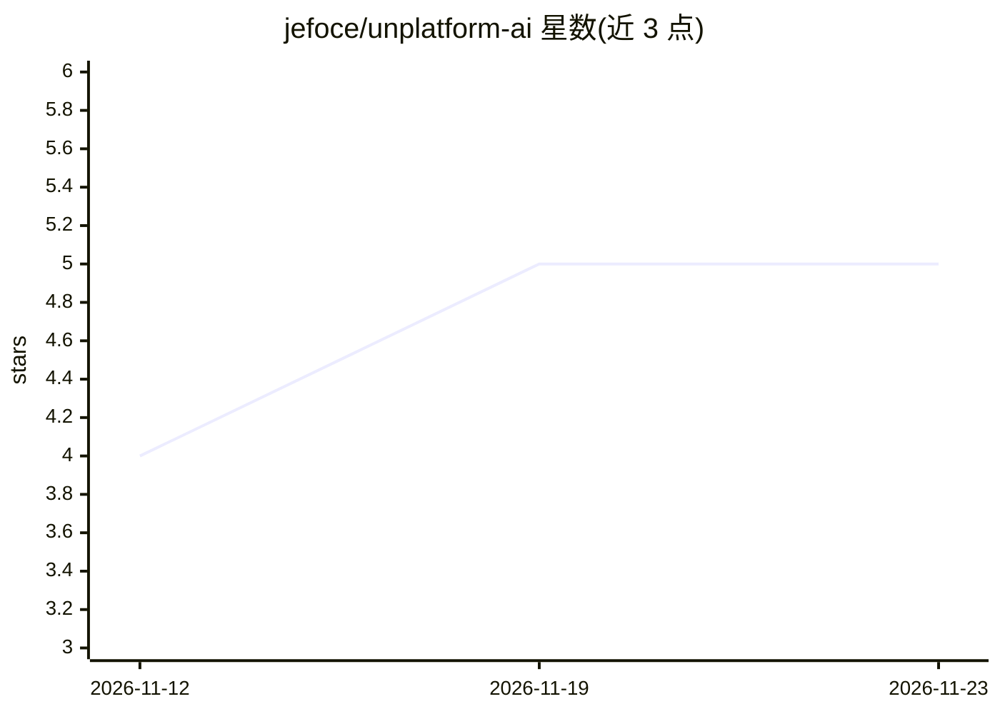

# jefoce/unplatform-ai

⭐ 5 · TypeScript · AGPL-3.0 · 推送 2026-11-21 · [GitHub](https://github.com/jefoce/unplatform-ai) · [官网](https://www.reddit.com/r/UnplatformAI/) · 个人维护

**桌面应用：用自有 OpenRouter key 或 ComfyUI 生成 AI 图像与视频**

跨平台桌面应用，用户通过自己的 OpenRouter API key 调用云端图像/视频模型，生成前显示价格、生成后保留真实成本记录，文件保存在本机。也支持通过 ComfyUI（需配套自定义节点包）在本地或局域网运行图像与视频模型，无需 OpenRouter key。支持文本/参考图/起止帧输入、批量浏览与重生成、最多各 4 个任务并行。提供 macOS/Windows/Linux 安装包，应用本身免费且不另加价。

## 筛选速览

| 维度 | 判定 | 备注 |
|---|---|---|
| AI 角色 | `ai-native` | 本体是模型或模型工具 |
| 许可风险 | `viral` | AGPL-3.0 |
| 部署形态 | `desktop` | 安装包/桌面程序 |
| 模型依赖 | locked-api |  |
| 硬件要求 | — | 无带数字的原话,不猜 |
| 安装摩擦 | `medium` | 含编译或系统依赖之一 |
| 成熟度 | — | 结构信号不足 |

## 能力要点

- 自有 OpenRouter key 按模型原价付费，生成前显示价格并有 10 秒取消窗口
- ComfyUI 节点包将本地保存的工作流发布为应用内可选模型
- 支持参考图/视频/音频引用并在提示词中定位引用
- 任务并行（图像视频各 4 个）与完成通知

## 适用场景

- 用按量付费方式生成 AI 视频而不订阅服务
- 通过 ComfyUI 运行本地图像/视频模型
- 集中管理生成的图片视频并按成本记录归档

## 场景标签

`图像生成` `视频生成` · 领域:内容生成

## 证据(README 行号)

> L4: > Make AI images and videos with today's most popular high-quality models on your own computer. Pay the model's pric
> L11: - Use local image and video models from ComfyUI on the same computer or your network, with no OpenRouter key for th
> L28: Local models from ComfyUI appear in the picker when you add an endpoint in Settings. Their names and settings come 

## 星数曲线

2026-11-12 4 → 2026-11-23 5（+1）

---
*卡片 v1 · prompt 1.4 · 生成 2026-11-21 · 置信度 high · 依据 README sha `0562edd75ff5` · [字段定义](../../DATASET.md)*
