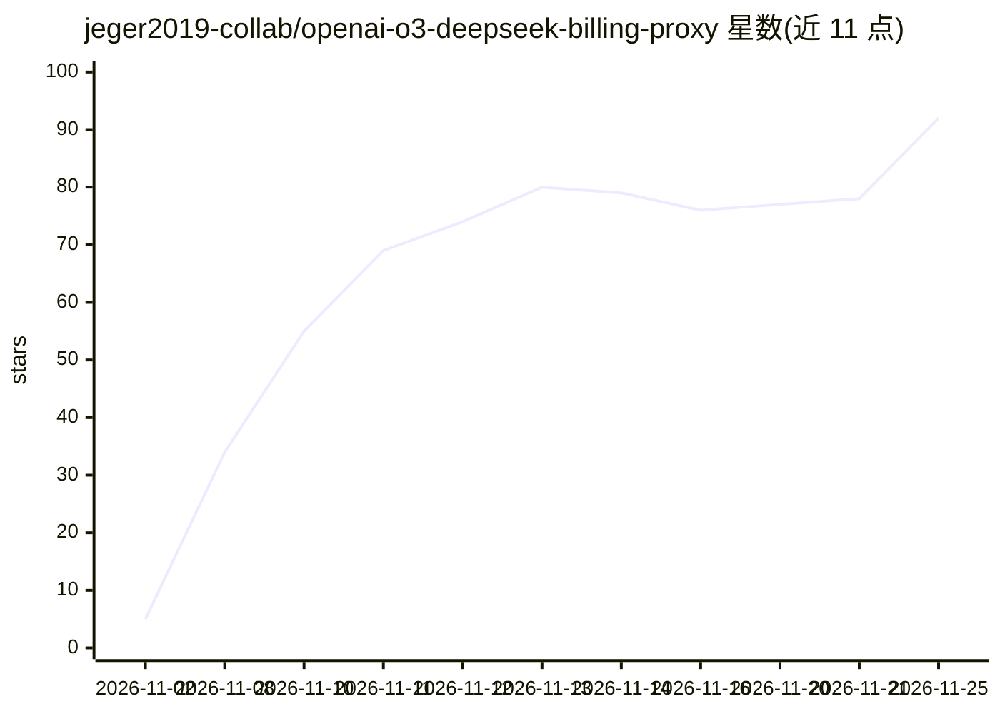

# jeger2019-collab/openai-o3-deepseek-billing-proxy

⭐ 92 · 推送 2026-11-02 · [GitHub](https://github.com/jeger2019-collab/openai-o3-deepseek-billing-proxy) · [官网](https://app.coregold.io/signup?invite_code=ADvlj9b) · 组织维护 · 中文 README

**面向 AI API 用户的虚拟卡支付方案推广文（CoreGold）**

名为 billing-proxy 的仓库，README 实际内容为介绍 CoreGold 商业级虚拟卡的推广文章：分析 OpenAI o1/o3-mini 与 Claude 3.7 高推理消耗下的扣费风控问题（动态预授权穿透、Stripe Radar BIN 降权、AVS 地址验证失败），说明国内双币卡报 402 的原因，并推介以欧美 Tier-1 Commercial BIN 虚拟卡作为支付方案。可见范围内未出现可安装运行的代码或安装步骤。

## 筛选速览

| 维度 | 判定 | 备注 |
|---|---|---|
| AI 角色 | `ai-enhanced` | 去掉 AI 部分产品仍成立 |
| 许可风险 | `none` | — |
| 部署形态 | `None` |  |
| 模型依赖 | — | README 未给出锁定关系 |
| 硬件要求 | — | 无带数字的原话,不猜 |
| 安装摩擦 | `low` | 无编译、无系统依赖或容器化 |
| 成熟度 | — | 结构信号不足 |

## 能力要点

- 分析高 Reasoning Effort 带来的高频小额扣款与预授权风控问题
- 列举 3 类扣费失败场景（预授权穿透、BIN 降权、AVS 断层）
- 推介 CoreGold 虚拟卡作为支付灾备方案

## 适用场景

- 了解 AI API 支付被 402 风控拦截的原因
- 寻找可用于 OpenAI/Anthropic API 扣费的虚拟卡方案

## 场景标签

 · 领域:AI API 支付/金融工具

## 证据(README 行号)

> L10: 利用 **CoreGold** 商业级虚拟卡，可以直接在网络清算底层焊死一道兼具高过检率与防穿透的“物理保险丝”。
> L6: 随着 OpenAI o1/o3-mini 与 Claude 3.7 Sonnet 混合推理机制的普及，高 Reasoning Effort 带来的 Token 消耗呈指数级上升。伴随而来的，是收单网关前所未有的高频小额扣款与动态预授

## 星数曲线

2026-11-02 5 → 2026-11-25 92（+87）

---
*卡片 v1 · prompt 1.4 · 生成 2026-11-18 · 置信度 low · 依据 README sha `19b497078dec` · [字段定义](../../DATASET.md)*
