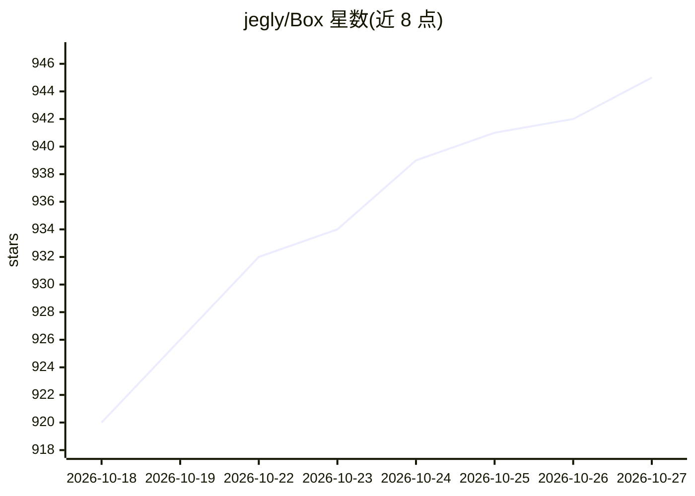

# jegly/Box

⭐ 945 · Kotlin · NOASSERTION · 推送 2026-10-25 · [GitHub](https://github.com/jegly/Box) · [官网](https://jegly.xyz) · 个人维护

**Android 端离线 AI 套件：本地聊天、图像生成与多种 AI 工具**

Google AI Edge Gallery 的安全加固分支，面向 Android 用户的全离线客户端 AI 应用：内置 40+ 模型的本地聊天、Ask Image 视觉问答、Bonsai/FLUX.2 klein/Z-Image 端侧图像生成、图像超分/去噪/照片修复、人脸识别、语音模式与多语言 TTS、文档分析与 Q&A、RAG 与 MCP 服务器支持。推理引擎覆盖 llama.cpp、stable-diffusion.cpp、whisper.cpp、LiteRT，支持 GGUF 导入，GPU 与 Snapdragon/Tensor/MediaTek NPU 加速。提供 APK 下载与 Obtainium 安装，含应用内更新器；分 Main 与 Custom ROM 两个版本。

## 筛选速览

| 维度 | 判定 | 备注 |
|---|---|---|
| AI 角色 | `ai-native` | 本体是模型或模型工具 |
| 许可风险 | `none` | NOASSERTION |
| 部署形态 | `desktop` | 安装包/桌面程序 |
| 模型依赖 | local-ok | 支持本地模型 |
| 硬件要求 | — | 无带数字的原话,不猜 |
| 安装摩擦 | `low` | 无编译、无系统依赖或容器化 |
| 成熟度 | — | 结构信号不足 |

## 能力要点

- 40+ 模型本地聊天，支持 GGUF 导入与多引擎（llama.cpp/whisper.cpp/stable-diffusion.cpp/LiteRT）
- 端侧图像生成（Bonsai Image 4B、FLUX.2 klein、Z-Image Turbo）与超分/去噪/修复
- 语音模式、多语言 TTS、文档分析 Q&A、RAG 与 MCP 服务器支持
- GPU 与 Snapdragon/Tensor/MediaTek NPU 加速；生物锁、SQLCipher 加密聊天记录等加固措施

## 适用场景

- 在 Android 手机上离线运行 LLM 聊天与视觉问答
- 端侧生成与编辑图片（生成、超分、去blur、消除/inpainting）
- 低视力用户使用 Box Assist 语音相机辅助
- 隐私敏感场景下本地完成文档分析与转录

## 场景标签

`聊天机器人` `图像生成` `文档问答` `图像视频处理` · 领域:对话与助手

## 证据(README 行号)

> L78: **Box is a security-hardened, feature rich fork of Google AI Edge Gallery — with on-device image generation (Bonsai
> L83: Box began as a fork of Google AI Edge Gallery and is not affiliated with or endorsed by Google LLC. Google branding

## 星数曲线

2026-10-18 920 → 2026-10-27 945（+25）

---
*卡片 v1 · prompt 1.4 · 生成 2026-10-21 · 置信度 high · 依据 README sha `8988e08c7e9e` · [字段定义](../../DATASET.md)*
