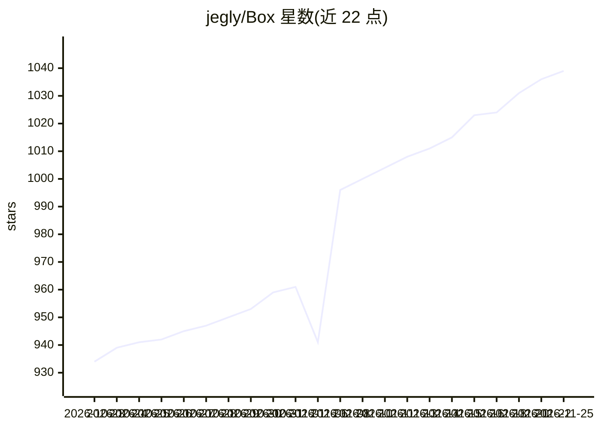

# jegly/Box

⭐ 1,039 · Kotlin · NOASSERTION · 推送 2026-11-24 · [GitHub](https://github.com/jegly/Box) · [官网](https://jegly.xyz) · 个人维护

**Android 全离线端侧 AI 套件，覆盖文本/图像/语音/视觉**

Google AI Edge Gallery 的 fork，Android 端侧应用，功能完全离线运行：文本聊天、图像生成（Bonsai/FLUX.2 klein/Z-Image Turbo/iris-3b）、语音对话、文档分析与问答、视觉 AI、背景去除、去模糊去噪、照片矫正、音乐生成等。引擎基于 llama.cpp、stable-diffusion.cpp、whisper.cpp 与 LiteRT，支持 GGUF 导入，并调用 Snapdragon/Tensor/MediaTek NPU 与 GPU 加速。带生物识别锁与加密聊天记录。通过 APK 或 Obtainium 安装，区分原生 Android 与无 Google 服务的自定义 ROM 两个版本；移除 Firebase 与 Google 使用记录组件。

## 筛选速览

| 维度 | 判定 | 备注 |
|---|---|---|
| AI 角色 | `ai-native` | 本体是模型或模型工具 |
| 许可风险 | `none` | NOASSERTION |
| 部署形态 | `desktop` | 安装包/桌面程序 |
| 模型依赖 | local-ok | 支持本地模型 |
| 硬件要求 | — | 无带数字的原话,不猜 |
| 安装摩擦 | `low` | 无编译、无系统依赖或容器化 |
| 成熟度 | — | 结构信号不足 |

## 能力要点

- 完全离线运行，内置 U²-Net 等模型，无 Google Play services 依赖
- GGUF 模型导入与 llama.cpp 引擎支持
- Snapdragon/Tensor/MediaTek NPU 与 Vulkan GPU 加速
- 面向视障用户的 Box Assist 语音相机辅助

## 适用场景

- 在 GrapheneOS/LineageOS 等无 Google 服务手机上运行本地 AI
- 端侧生成图像、去噪去模糊与照片矫正
- 离线语音对话与文档问答

## 场景标签

`图像生成` `文档问答` `语音 Agent` · 领域:对话与助手

## 证据(README 行号)

> L78: **Box is a security-hardened, feature rich fork of Google AI Edge Gallery — with on-device image generation (Bonsai
> L83: Box began as a fork of Google AI Edge Gallery and is not affiliated with or endorsed by Google LLC. Google branding
> L90: |v3.5.7|**🌍 New model: Hy-MT2-1.8B — translation**|Tencent's 1.8B translation model, for translating text between *

## 星数曲线

2026-10-23 934 → 2026-11-25 1,039（+105）

---
*卡片 v1 · prompt 1.4 · 生成 2026-11-24 · 置信度 high · 依据 README sha `3e8620c15ab9` · [字段定义](../../DATASET.md)*
