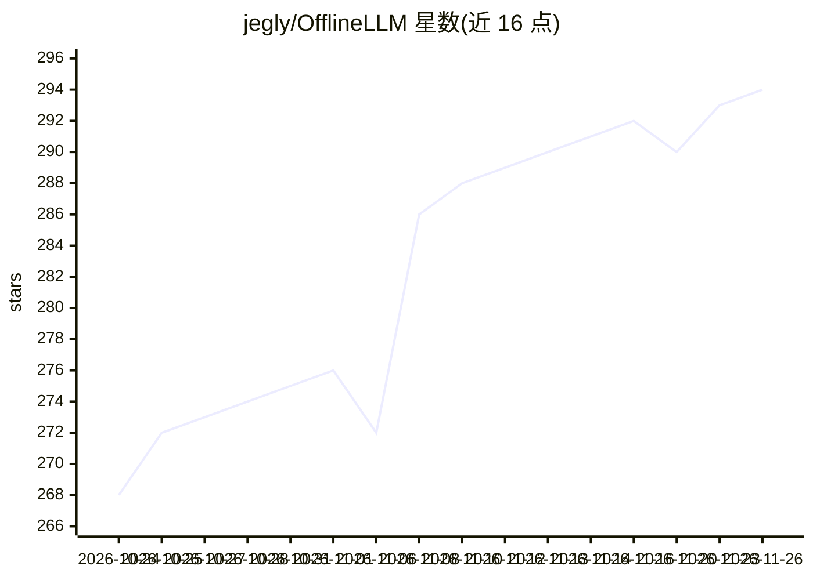

# jegly/OfflineLLM

⭐ 294 · Kotlin · NOASSERTION · 推送 2026-11-24 · [GitHub](https://github.com/jegly/OfflineLLM) · [官网](https://jegly.xyz) · 个人维护

**Android 本地离线 AI 聊天应用，经 llama.cpp 运行 GGUF 模型**

面向 Android 的本地大模型聊天客户端：通过 llama.cpp 在设备端推理用户导入的 GGUF 模型，manifest 不含 INTERNET 权限。推理侧按 SoC 特性在七种 CPU 内核变体间分派，支持可选 Vulkan GPU 卸载、增量 KV 缓存多轮对话与流式输出；安全侧提供加密设置、生物识别锁、启动时 APK 签名证书校验及 ML-DSA-87 后量子混合签名发布。安装为单个 APK，需 Android 13+ 与 arm64-v8a；源码构建需 JDK 17、NDK、CMake 等工具链。

## 筛选速览

| 维度 | 判定 | 备注 |
|---|---|---|
| AI 角色 | `ai-native` | 本体是模型或模型工具 |
| 许可风险 | `none` | NOASSERTION |
| 部署形态 | `None` |  |
| 模型依赖 | local-ok | 支持本地模型 |
| 硬件要求 | — | 无带数字的原话,不猜 |
| 安装摩擦 | `high` | 编译与系统依赖俱全 |
| 成熟度 | — | 结构信号不足 |

## 能力要点

- GGUF 模型运行时导入，支持 Vulkan GPU 卸载与自动 CPU 回退
- 无 INTERNET 权限，设置加密、生物识别锁与防篡改签名校验
- 增量 prompt 处理：多轮对话仅处理新消息
- 75+ 语言翻译器、TTS 朗读与思考标签剥离

## 适用场景

- 在无网络环境下的 Android 手机上运行本地 LLM 对话
- 导入自己的 GGUF 模型进行隐私离线推理
- 在低端设备上按内存选择小型模型获得快速响应

## 场景标签

`聊天机器人` · 领域:对话与助手

## 证据(README 行号)

> L3: The only Android LLM app that has 0 Network connectivity. All LLM inference runs on-device via llama.cpp.
> L34: - **100% Offline** — no INTERNET permission in the manifest, cannot phone home
> L40: - **Import Any Model** — bring your own GGUF at runtime via file picker

## 星数曲线

2026-10-24 268 → 2026-11-26 294（+26）

---
*卡片 v1 · prompt 1.4 · 生成 2026-11-25 · 置信度 high · 依据 README sha `e666bd9c7a6b` · [字段定义](../../DATASET.md)*
