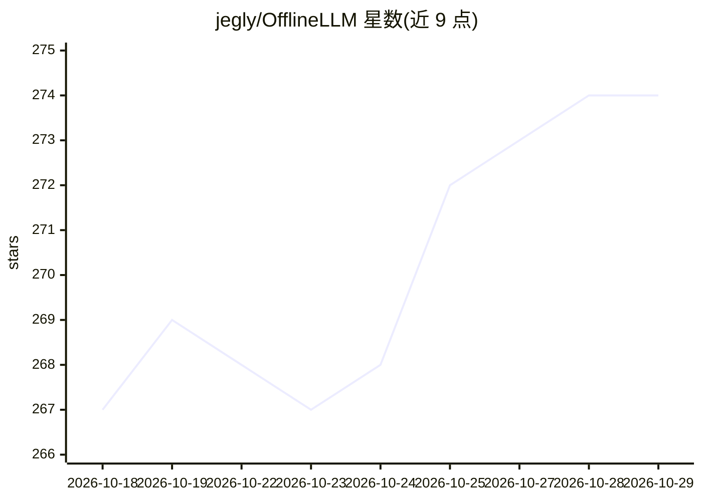

# jegly/OfflineLLM

⭐ 274 · Kotlin · NOASSERTION · 推送 2026-10-27 · [GitHub](https://github.com/jegly/OfflineLLM) · [官网](https://jegly.xyz) · 个人维护

**Android 全离线本地 LLM 聊天应用，通过 llama.cpp 运行 GGUF 模型**

面向 Android 用户的本地大模型聊天应用：以 llama.cpp 为推理引擎，在设备端运行用户自带的 GGUF 模型，清单中无任何网络权限。支持按 SoC 特性自动选择 CPU 内核（dotprod/fp16/i8mm/SVE）、可选 Vulkan GPU 卸载与自动 CPU 回退、增量 KV 缓存的多轮对话、流式输出、采样参数与系统提示词、75+ 语言翻译、TTS 与 Markdown 渲染。安全方面提供加密设置、生物识别锁、APK 签名校验的防篡改检测。以单个 APK 发布，需 Android 13+ 与 arm64-v8a，也可从源码编译（需 JDK 17 与 NDK）。

## 筛选速览

| 维度 | 判定 | 备注 |
|---|---|---|
| AI 角色 | `ai-native` | 本体是模型或模型工具 |
| 许可风险 | `none` | NOASSERTION |
| 部署形态 | `None` |  |
| 模型依赖 | local-ok | 支持本地模型 |
| 硬件要求 | — | 无带数字的原话,不猜 |
| 安装摩擦 | `high` | 编译与系统依赖俱全 |
| 成熟度 | — | 结构信号不足 |

## 能力要点

- 清单零网络权限，推理全部在设备端经 llama.cpp 完成
- 七个 armv8.0→armv9.2 CPU 内核变体按 SoC 自动选择，可选 Vulkan GPU 卸载
- 增量提示处理：多轮对话仅处理新消息进 KV 缓存
- 加密设置、生物识别锁、APK 签名防篡改校验

## 适用场景

- 在无网络环境下用本地 GGUF 模型聊天或翻译
- 隐私敏感场景下运行 LLM，应用无法联网上报
- 按自己设备的 RAM 挑选量化模型随身使用

## 场景标签

`聊天机器人` · 领域:对话与助手

## 证据(README 行号)

> L3: The only Android LLM app that has 0 Network connectivity. All LLM inference runs on-device via llama.cpp.
> L35: - **On-Device Inference** — GGUF models via llama.cpp; runtime CPU dispatch picks the best kernel set (dotprod / fp

## 星数曲线

2026-10-18 267 → 2026-10-29 274（+7）

---
*卡片 v1 · prompt 1.4 · 生成 2026-10-22 · 置信度 high · 依据 README sha `65887551dcec` · [字段定义](../../DATASET.md)*
