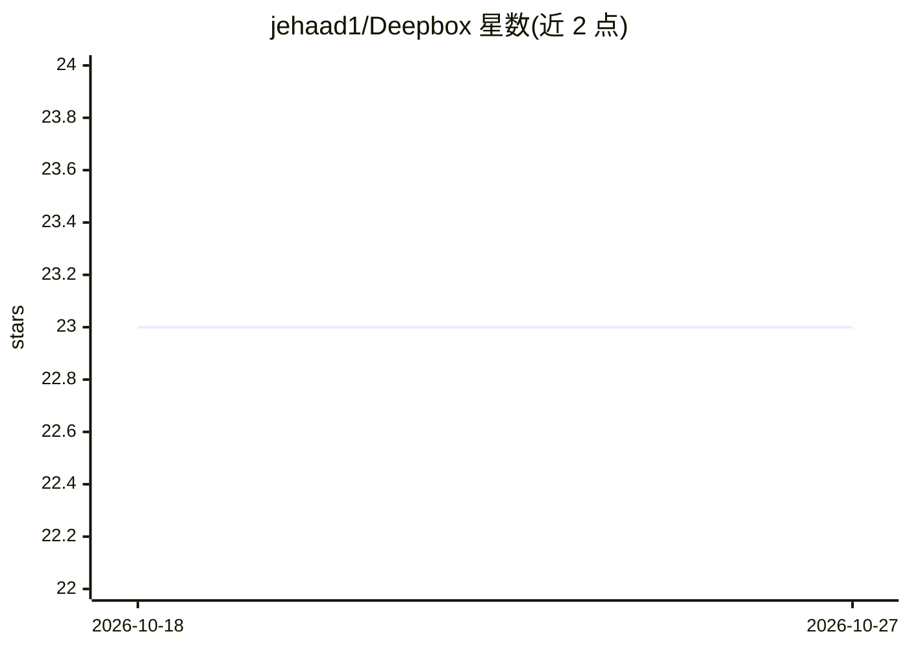

# jehaad1/Deepbox

⭐ 23 · TypeScript · MIT · 推送 2026-10-09 · [GitHub](https://github.com/jehaad1/Deepbox) · [官网](https://deepbox.dev) · 个人维护

**TypeScript 的张量/线代/ML/神经网络/统计数值计算工具库**

Deepbox 是零运行时依赖的 TypeScript 库，覆盖张量与自动微分、线性代数、DataFrame、经典机器学习、神经网络、统计、数据集与绘图，API 设计对齐 NumPy/pandas/scikit-learn/PyTorch。提供 15 个子路径模块；张量带 device 概念，WebGPU 后端以 WGSL compute kernel 加速部分算子，WASM 后端对 float32 逐元素运算做 SIMD 加速，其余算子需回 CPU。要求 Node.js >= 24.13.0，1.5 相对 1.0 有 dtype 规则等行为变更，另附面向编码 agent 的 SKILL.md 指南。

## 筛选速览

| 维度 | 判定 | 备注 |
|---|---|---|
| AI 角色 | `ai-native` | 本体是模型或模型工具 |
| 许可风险 | `permissive` | MIT |
| 部署形态 | `library` | 以包/库形式分发 |
| 模型依赖 | — | README 未给出锁定关系 |
| 硬件要求 | — | 无带数字的原话,不猜 |
| 安装摩擦 | `low` | 无编译、无系统依赖或容器化 |
| 成熟度 | — | 结构信号不足 |

## 能力要点

- 张量/自动微分/神经网络训练与经典 ML（fit/predict/score 模式）
- WebGPU 后端以 WGSL kernel、WASM 后端以 SIMD 加速部分算子
- 15 个子路径模块：ndarray/linalg/dataframe/stats/metrics/preprocess/ml/nn/optim/datasets/plot 等
- 零运行时依赖，提供 ESM 与 CommonJS 构建及类型声明

## 适用场景

- 在 TypeScript/JavaScript 项目中做张量运算与训练神经网络
- 用 DataFrame 处理表格数据并做统计分析与绘图
- 在浏览器或 Node 环境用 WebGPU/WASM 后端加速数值计算

## 场景标签

 · 领域:科学计算/机器学习

## 证据(README 行号)

> L11: Deepbox is a TypeScript library for tensors, linear algebra, tabular data, machine learning, neural networks, stati
> L140: |`deepbox/ml`|Linear models, trees, ensembles, SVM, neighbors, Naive Bayes, clustering, manifold, pipelines, model
> L141: |`deepbox/nn`|Modules, layers, recurrent models, transformers, losses, training utilities, initialization|

## 星数曲线

2026-10-18 23 → 2026-10-27 23（+0）

---
*卡片 v1 · prompt 1.4 · 生成 2026-10-27 · 置信度 high · 依据 README sha `bfced086618a` · [字段定义](../../DATASET.md)*
