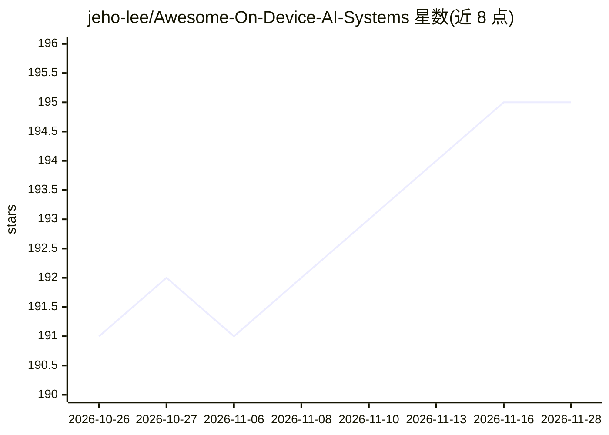

# jeho-lee/Awesome-On-Device-AI-Systems

⭐ 195 · 推送 2026-11-14 · [GitHub](https://github.com/jeho-lee/Awesome-On-Device-AI-Systems) · 个人维护

**面向移动/边缘设备的端侧 AI 系统资源清单**

一份关于端侧（on-device）高效 AI 系统的策展清单，内容分两大板块：推理引擎（通用 ML 运行时、LLM 专用引擎、NPU/DSP 厂商 SDK）与研究论文（按移动 SoC 推理、量化/稀疏化、注意力加速、端侧训练、性能剖析等主题分组）。定位是连接系统研究与实际部署，聚焦在资源受限硬件上优化 LLM/VLM、ViT 等模型。清单由个人维护，部分收录的论文实际面向云端推理加速，作者注明是因可能泛化到端侧场景而收录。

## 筛选速览

| 维度 | 判定 | 备注 |
|---|---|---|
| AI 角色 | `ai-knowledge` | 知识聚合/清单类 |
| 许可风险 | `none` | — |
| 部署形态 | `None` |  |
| 模型依赖 | — | README 未给出锁定关系 |
| 硬件要求 | — | 无带数字的原话,不猜 |
| 安装摩擦 | `low` | 无编译、无系统依赖或容器化 |
| 成熟度 | — | 结构信号不足 |

## 能力要点

- 收录推理引擎清单：LiteRT、ExecuTorch、ONNX Runtime、MNN、NCNN 等
- 按厂商整理 NPU/DSP 专属 SDK：Qualcomm QNN、Core ML、TensorRT、OpenVINO、NeuroPilot
- 研究论文按主题分组：LLM 移动推理、注意力加速、量化/稀疏、端侧训练、剖析工具

## 适用场景

- 为端侧部署选型推理引擎或厂商 SDK
- 查找移动/边缘设备上 LLM 推理与训练相关的系统研究论文
- 了解注意力加速与量化技术在资源受限设备上的研究进展

## 场景标签

`精选清单` · 领域:学习与行业

## 证据(README 行号)

> L3: A curated list of **efficient on-device AI systems**, including practical inference engines, benchmarks, and state-o
> L14: - 📝 Research Papers

## 星数曲线

2026-10-26 191 → 2026-11-28 195（+4）

---
*卡片 v1 · prompt 1.4 · 生成 2026-11-25 · 置信度 high · 依据 README sha `7ebd796199e6` · [字段定义](../../DATASET.md)*
