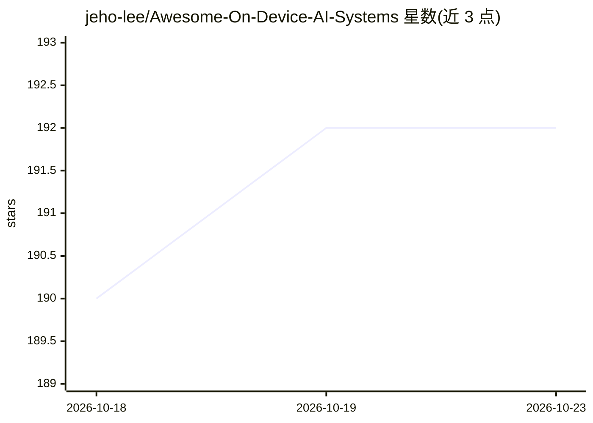

# jeho-lee/Awesome-On-Device-AI-Systems

⭐ 192 · 推送 2026-09-14 · [GitHub](https://github.com/jeho-lee/Awesome-On-Device-AI-Systems) · 个人维护

**端侧 AI 系统策展清单：推理引擎与顶会研究论文汇编**

面向移动与边缘设备的 on-device AI 系统资源清单：一部分收录可实际部署的推理引擎与 SDK，按通用 ML、LLM/GenAI 专用、厂商专用（NPU/DSP）组织，涵盖 LiteRT、ExecuTorch、ONNX Runtime、MNN、NCNN、llama.cpp、MLC LLM、MLX LM 等；另一部分按主题汇编系统方向研究论文（OSDI/SOSP/MobiSys/ASPLOS 等），覆盖 LLM 移动推理、量化、注意力加速、多 DNN 调度、端侧训练与性能分析工具。仓库本身为编目内容，不提供可运行的软件。

## 筛选速览

| 维度 | 判定 | 备注 |
|---|---|---|
| AI 角色 | `ai-knowledge` | 知识聚合/清单类 |
| 许可风险 | `none` | — |
| 部署形态 | `None` |  |
| 模型依赖 | — | README 未给出锁定关系 |
| 硬件要求 | — | 无带数字的原话,不猜 |
| 安装摩擦 | `low` | 无编译、无系统依赖或容器化 |
| 成熟度 | — | 结构信号不足 |

## 能力要点

- 收录跨平台与厂商专用（Qualcomm/Apple/MediaTek/NVIDIA/Intel）端侧推理引擎
- 按 8 个主题组织系统方向顶会论文（OSDI/SOSP/MobiSys/ASPLOS 等）
- 覆盖 LLM 推理、量化稀疏、多 DNN 调度、端侧训练、profiler 等方向

## 适用场景

- 为移动/边缘项目挑选端侧推理框架或厂商 SDK
- 按主题检索 on-device AI 系统方向的研究论文
- 了解端侧推理加速的研究脉络与开源工程对应关系

## 场景标签

`精选清单` · 领域:学习与行业

## 证据(README 行号)

> L3: A curated list of **efficient on-device AI systems**, including practical inference engines, benchmarks, and state-o
> L45: ## 📝 Research Papers

## 星数曲线

2026-10-18 190 → 2026-10-23 192（+2）

---
*卡片 v1 · prompt 1.4 · 生成 2026-10-22 · 置信度 high · 依据 README sha `268db133a251` · [字段定义](../../DATASET.md)*
