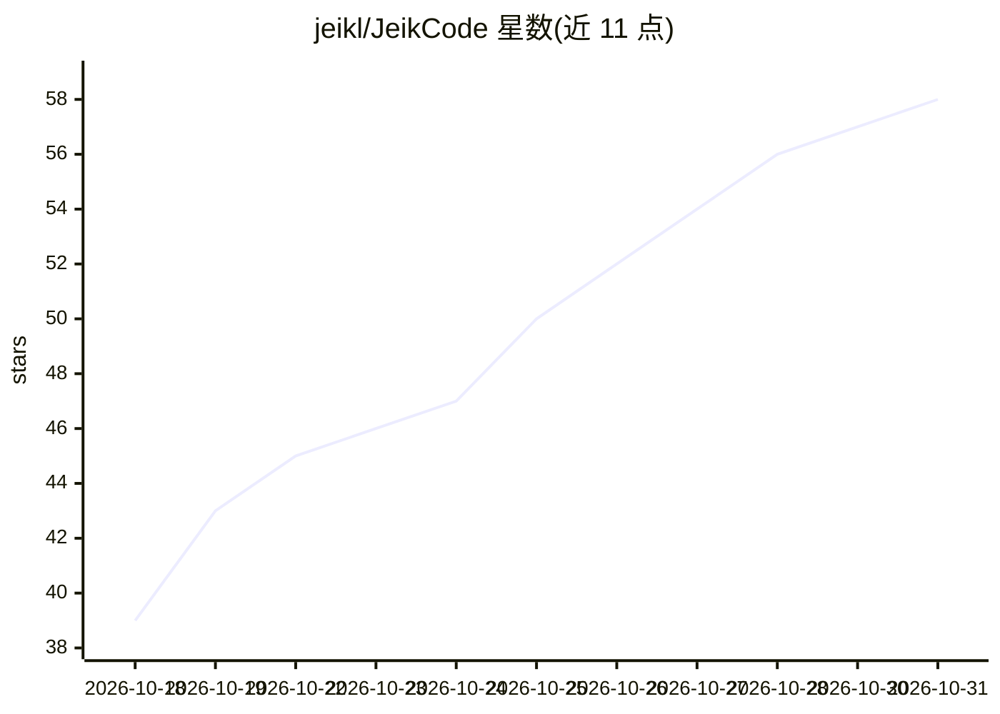

# jeikl/JeikCode

⭐ 58 · Rust · NOASSERTION · 推送 2026-10-29 · [GitHub](https://github.com/jeikl/JeikCode) · [官网](https://jeikcode.top) · 个人维护 · 中文 README

**Rust 编写的跨平台 AI 编码 Agent（TUI/WebUI/桌面/OpenWrt）**

以纯 Rust 实现的开源 AI 编码 Agent，面向高复杂度生产软件工程场景。提供基于 Tree-Sitter 的语义代码图谱（12+ 语言、增量补丁）、98–99% KV-Cache 前缀保护机制、约 9k 的精简系统提示、Git 类状态机原子文件编辑与一键回滚。原生支持 OpenAI Chat/Responses、Anthropic Claude、Google Gemini、Ollama 五种协议，并对外暴露 OpenAI/Anthropic/Gemini 兼容服务端点。运行覆盖 Windows/macOS/Linux(x86/ARM) 与 OpenWrt 路由器，提供桌面安装包、CLI 一键脚本与 MCP 集成。注意：许可证为改编自 CC BY-NC 4.0 的非商业许可，商用需另行授权。

## 筛选速览

| 维度 | 判定 | 备注 |
|---|---|---|
| AI 角色 | `ai-native` | 本体是模型或模型工具 |
| 许可风险 | `none` | NOASSERTION |
| 部署形态 | `desktop` | 安装包/桌面程序 |
| 模型依赖 | local-ok | 支持本地模型 |
| 硬件要求 | — | 无带数字的原话,不猜 |
| 安装摩擦 | `low` | 无编译、无系统依赖或容器化 |
| 成熟度 | — | 结构信号不足 |

## 能力要点

- Tree-Sitter 语义代码图谱，支持 12+ 语言与业务自然语言查询
- KV-Cache 前缀冻结保护（98–99%），宣称大幅降低 token 消耗
- TUI/WebUI/Tauri 桌面/后台守护进程/OpenWrt 多端统一运行
- 原生支持 OpenAI Chat/Responses、Anthropic、Gemini、Ollama 五种协议

## 适用场景

- 在终端或桌面用 AI Agent 进行复杂项目的编码与代码审查
- 在 OpenWrt 路由器等低功耗设备上运行编码 Agent
- 通过 OpenAI/Anthropic/Gemini 兼容端点让其他工具接入本 Agent

## 场景标签

`编码 Agent` · 领域:编码与开发

## 证据(README 行号)

> L34: **JeikCode** is a next-generation, cross-platform, full-featured open-source AI Coding Agent built natively in pure
> L41: - 🔄 **Native Support for 5 Industry Protocols**: Seamlessly integrates `OpenAI Chat`, `OpenAI Responses`, `Anthropi

## 星数曲线

2026-10-18 39 → 2026-10-31 58（+19）

---
*卡片 v1 · prompt 1.4 · 生成 2026-10-24 · 置信度 high · 依据 README sha `8d0c37ddd82e` · [字段定义](../../DATASET.md)*
