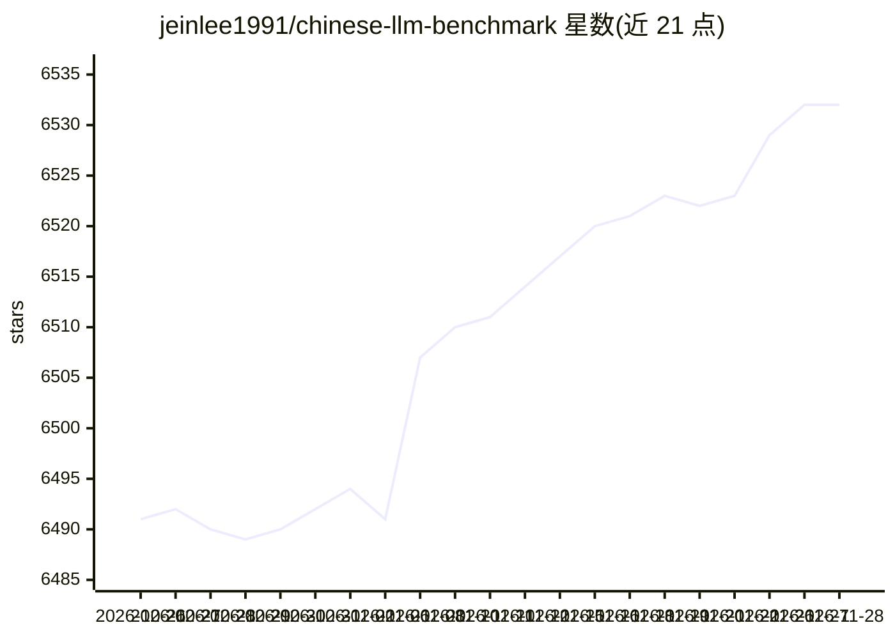

# jeinlee1991/chinese-llm-benchmark

⭐ 6,532 · 推送 2026-11-27 · [GitHub](https://github.com/jeinlee1991/chinese-llm-benchmark) · [官网](https://nonelinear.com.cn) · 组织维护 · 中文 README

**面向中文社区的中文大模型能力评测排行榜与缺陷库**

非线智能维护的中文大模型评测项目（ReLE，原名CLiB），持续更新评测榜单，累计覆盖423个大模型，涵盖商用与开源模型。评测按教育、医疗与心理健康、金融、法律与行政公务、推理与数学计算、语言与指令遵从、agent与工具调用等7个领域组织，细分约300个维度，并提供细分类目榜单（如高考各学科、各科医师职称）与badcase链接。项目还维护超200万条的大模型缺陷库，提供技术报告，并附带免费的私有大模型评测服务（需联系团队）。README另含模型网关与选型工具的商业化介绍。

## 筛选速览

| 维度 | 判定 | 备注 |
|---|---|---|
| AI 角色 | `ai-knowledge` | 知识聚合/清单类 |
| 许可风险 | `none` | — |
| 部署形态 | `None` |  |
| 模型依赖 | — | README 未给出锁定关系 |
| 硬件要求 | — | 无带数字的原话,不猜 |
| 安装摩擦 | `low` | 无编译、无系统依赖或容器化 |
| 成熟度 | — | 结构信号不足 |

## 能力要点

- 覆盖423个大模型的中文能力评测榜单，持续更新并记录各版本变更
- 7大领域约300个细分维度评测，含多模态理解与图片生成榜单
- 超200万条大模型缺陷库对外开放供社区研究
- 榜单附badcase明细与DIY自定义维度筛选

## 适用场景

- 选型时查看中文大模型在各行业领域的准确率排名
- 研究分析大模型在高考真题、医师职称考试等细分场景的表现
- 从缺陷库中获取badcase用于模型改进研究

## 场景标签

`模型评测` · 领域:评测与运维

## 证据(README 行号)

> L1: # 非线智能 NoneLinear - ReLE评测：中文AI大模型能力评测（持续更新）
> L5: - 支持多维度能力评测，包括教育、医疗与心理健康、金融、法律与行政公务、推理与数学计算、语言与指令遵从、agent与工具调用等7个领域，以及细分的~300个维度（比如牙科、高中语文…）。详见我们的技术报告ReLE: A Scalab
> L6: - 不仅提供排行榜，也提供规模**超200万的大模型缺陷库**！方便广大社区研究分析、改进大模型。

## 星数曲线

2026-10-26 6,491 → 2026-11-28 6,532（+41）

---
*卡片 v1 · prompt 1.4 · 生成 2026-11-28 · 置信度 high · 依据 README sha `babeae29b11f` · [字段定义](../../DATASET.md)*
