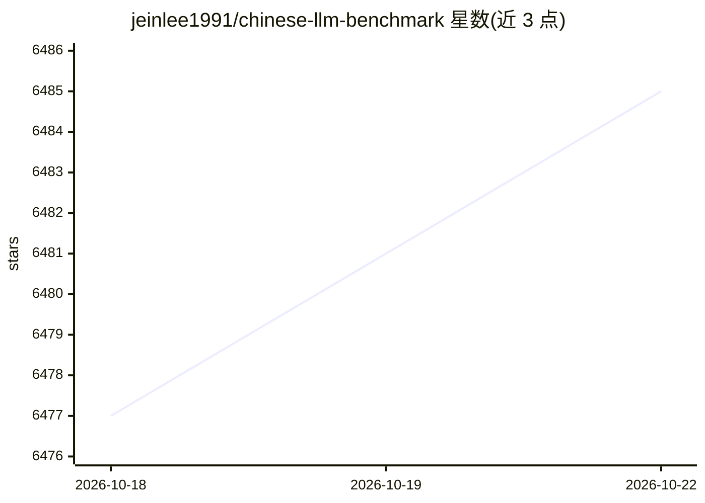

# jeinlee1991/chinese-llm-benchmark

⭐ 6,485 · 推送 2026-10-21 · [GitHub](https://github.com/jeinlee1991/chinese-llm-benchmark) · [官网](https://nonelinear.com.cn) · 组织维护 · 中文 README

**中文大模型能力评测排行榜：覆盖413个模型的持续更新基准**

非线智能（NoneLinear）维护的 ReLE（原 CLiB）中文大模型能力评测项目：收录 413 个商用与开源大模型，在教育、医疗与心理健康、金融、法律与行政公务、推理与数学计算、语言与指令遵从、agent 与工具调用等 7 个领域、约 300 个细分维度上持续评测并发布排行榜，另维护规模超 200 万的大模型缺陷库（badcase）。按学科/科室逐项提供排行榜与 badcase 数据，并为私有大模型提供免费评测服务。项目同时推广同公司的模型统一网关与模型选型服务。仓库为数据与榜单聚合形式，README 未给出本产品的安装运行方式。

## 筛选速览

| 维度 | 判定 | 备注 |
|---|---|---|
| AI 角色 | `ai-knowledge` | 知识聚合/清单类 |
| 许可风险 | `none` | — |
| 部署形态 | `None` |  |
| 模型依赖 | — | README 未给出锁定关系 |
| 硬件要求 | — | 无带数字的原话,不猜 |
| 安装摩擦 | `low` | 无编译、无系统依赖或容器化 |
| 成熟度 | — | 结构信号不足 |

## 能力要点

- 收录 413 个商用与开源大模型，持续更新（2023 年至今）
- 7 大领域、约 300 个细分维度的评测维度体系
- 规模超 200 万的大模型缺陷库（badcase）
- 多模态理解、图片生成、综合能力等多类排行榜

## 适用场景

- 为中文场景选型大模型时查阅各领域排行榜
- 分析各模型在具体学科或医学科室上的 badcase
- 对比商用与开源模型的准确率、耗时、token 消耗与费用

## 场景标签

`模型评测` · 领域:评测与运维

## 证据(README 行号)

> L3: - 目前已囊括413个大模型，覆盖chatgpt、gpt-6、gpt-6.1、谷歌gemini-4、Claude-5.5、grok-4.7、文心ERNIE-X1.1、ERNIE-5.1、qwen3.8-max、step-5、商汤se
> L5: - 支持多维度能力评测，包括教育、医疗与心理健康、金融、法律与行政公务、推理与数学计算、语言与指令遵从、agent与工具调用等7个领域，以及细分的~300个维度（比如牙科、高中语文…）。详见我们的技术报告ReLE: A Scalab
> L6: - 不仅提供排行榜，也提供规模**超200万的大模型缺陷库**！方便广大社区研究分析、改进大模型。

## 星数曲线

2026-10-18 6,477 → 2026-10-22 6,485（+8）

---
*卡片 v1 · prompt 1.4 · 生成 2026-10-20 · 置信度 high · 依据 README sha `87e877f2bafd` · [字段定义](../../DATASET.md)*
