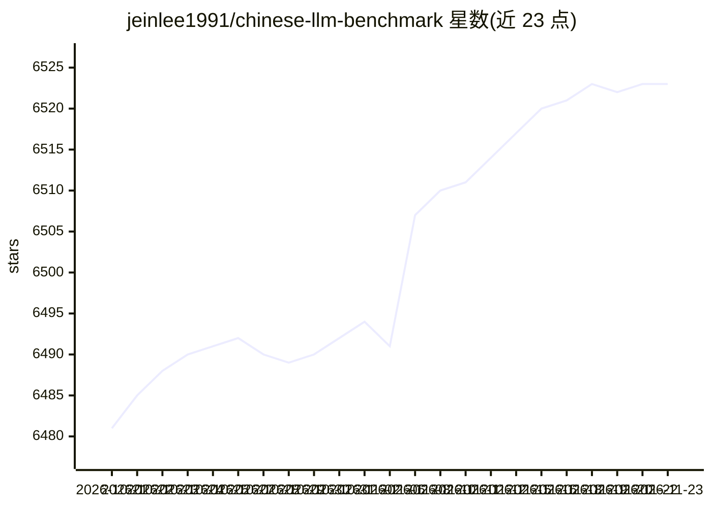

# jeinlee1991/chinese-llm-benchmark

⭐ 6,523 · 推送 2026-11-20 · [GitHub](https://github.com/jeinlee1991/chinese-llm-benchmark) · [官网](https://nonelinear.com.cn) · 组织维护 · 中文 README

**中文大模型能力评测排行榜，覆盖数百个模型**

ReLE（原名 CLiB）是持续更新的中文大模型评测项目：覆盖 400+ 商用与开源模型，按教育、医疗与心理健康、金融、法律与行政公务、推理与数学、语言与指令遵从、agent 与工具调用等 7 个领域约 300 个细分维度输出排行榜，并附 badcase 构成的缺陷库与多模态理解、图片生成榜单。README 同时提供其商业化的模型网关（API 聚合）与按自有测试数据的模型选型服务入口。

## 筛选速览

| 维度 | 判定 | 备注 |
|---|---|---|
| AI 角色 | `ai-knowledge` | 知识聚合/清单类 |
| 许可风险 | `none` | — |
| 部署形态 | `None` |  |
| 模型依赖 | — | README 未给出锁定关系 |
| 硬件要求 | — | 无带数字的原话,不猜 |
| 安装摩擦 | `low` | 无编译、无系统依赖或容器化 |
| 成熟度 | — | 结构信号不足 |

## 能力要点

- 覆盖 400+ 商用与开源模型的中文评测排行榜
- 7 个领域、约 300 个细分评测维度（如牙科、高中语文、医师职称）
- 超 200 万条大模型缺陷库（badcase）供社区研究
- 含多模态理解与图片生成（8 个细分维度）榜单

## 适用场景

- 选型前查看模型在中文细分领域（高考、医师考试等）的准确率
- 研究某模型的 badcase 以定位能力缺陷
- 了解各时期新旧中文模型评测分数变化

## 场景标签

`模型评测` · 领域:评测与运维

## 证据(README 行号)

> L1: # 非线智能 NoneLinear - ReLE评测：中文AI大模型能力评测（持续更新）
> L5: - 支持多维度能力评测，包括教育、医疗与心理健康、金融、法律与行政公务、推理与数学计算、语言与指令遵从、agent与工具调用等7个领域，以及细分的~300个维度（比如牙科、高中语文…）。详见我们的技术报告ReLE: A Scalab
> L123: # 📊 排行榜

## 星数曲线

2026-10-21 6,481 → 2026-11-23 6,523（+42）

---
*卡片 v1 · prompt 1.4 · 生成 2026-11-22 · 置信度 high · 依据 README sha `3b1958c0c0f9` · [字段定义](../../DATASET.md)*
