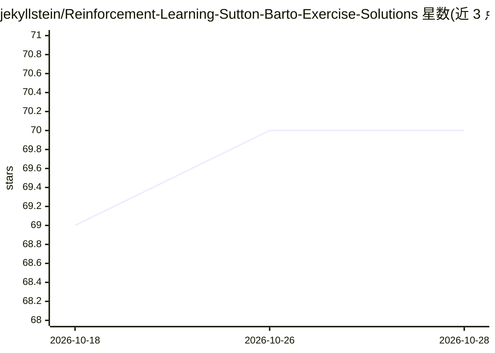

# jekyllstein/Reinforcement-Learning-Sutton-Barto-Exercise-Solutions

⭐ 70 · Julia · Unlicense · 推送 2026-10-02 · [GitHub](https://github.com/jekyllstein/Reinforcement-Learning-Sutton-Barto-Exercise-Solutions) · [官网](https://jekyllstein.github.io/Reinforcement-Learning-Sutton-Barto-Exercise-Solutions/) · 个人维护

**Sutton & Barto《强化学习导论》第二版的章节笔记与习题解答集**

为 Richard S. Sutton 与 Andrew G. Barto 所著《Reinforcement Learning: An Introduction》（第二版）提供章节笔记与习题解答。内容主要以 Pluto Notebooks 格式编写，使用 Julia 语言，可在本地运行并交互编辑；同时提供静态 HTML 导出版本供浏览器在线查看。仓库包含一个 PlutoStartup 启动环境，通过克隆仓库并运行 julia 命令或 start.sh 脚本即可设置 Pluto 并浏览本地笔记本；另有 YouTube 上学习小组在线讨论会议的录像。作者注明静态导出尚不完整，正在逐章补充。

## 筛选速览

| 维度 | 判定 | 备注 |
|---|---|---|
| AI 角色 | `ai-knowledge` | 知识聚合/清单类 |
| 许可风险 | `permissive` | Unlicense |
| 部署形态 | `None` |  |
| 模型依赖 | — | README 未给出锁定关系 |
| 硬件要求 | — | 无带数字的原话,不猜 |
| 安装摩擦 | `low` | 无编译、无系统依赖或容器化 |
| 成熟度 | `idea` | |

## 能力要点

- Pluto Notebooks 格式的章节笔记与习题解答，使用 Julia 语言
- 提供静态 HTML 导出版本在线浏览
- 附带 PlutoStartup 启动环境一键配置本地运行
- 配套 YouTube 在线讨论会议录像

## 适用场景

- 自学《强化学习导论》时查阅习题解答与笔记
- 在本地交互式运行和修改笔记内容
- 参与或回看强化学习学习小组的讨论录像

## 场景标签

`教程课程` · 领域:学习与行业

## 证据(README 行号)

> L3: Chapter notes and exercise solutions for Reinforcement Learning: An Introduction, 2nd edition
> L6: The notes are mostly in the format of Pluto Notebooks which are interactive HTML notebooks that use the Julia Progra

## 星数曲线

2026-10-18 69 → 2026-10-28 70（+1）

---
*卡片 v1 · prompt 1.4 · 生成 2026-10-24 · 置信度 high · 依据 README sha `7f669d6019c9` · [字段定义](../../DATASET.md)*
