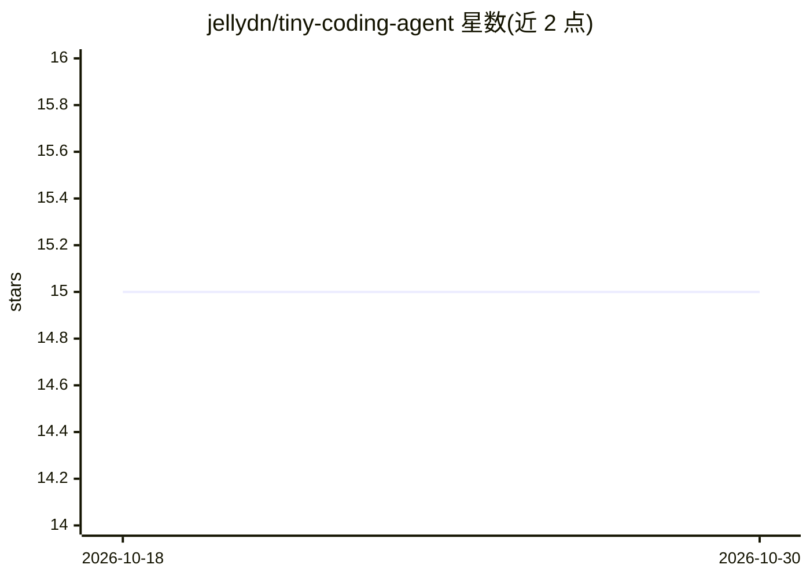

# jellydn/tiny-coding-agent

⭐ 15 · TypeScript · MIT · 推送 2026-10-26 · [GitHub](https://github.com/jellydn/tiny-coding-agent) · 个人维护 · 中文 README

**TypeScript 编写的轻量可扩展终端编码 agent**

基于 TypeScript 与 Ink 的 CLI 编码助手，面向在 TypeScript/React/Node.js/Bash 等技术栈上做编码任务的开发者。支持 OpenAI、Anthropic、Ollama、OpenRouter、OpenCode、Z.AI、ClinePass、QwenCloud 八家 LLM 提供商，内置文件操作、bash 执行、grep/glob 与网页搜索工具；集成 MCP 客户端、SKILL.md 技能系统、插件与生命周期钩子，危险工具执行前需确认。提供脚本一键安装、Homebrew 与源码构建三种安装方式，另支持 JSON 输出模式供工具集成。

## 筛选速览

| 维度 | 判定 | 备注 |
|---|---|---|
| AI 角色 | `ai-ecosystem` | LLM/agent 周边工具 |
| 许可风险 | `permissive` | MIT |
| 部署形态 | `library` | 以包/库形式分发 |
| 模型依赖 | local-ok | 支持本地模型 |
| 硬件要求 | — | 无带数字的原话,不猜 |
| 安装摩擦 | `low` | 无编译、无系统依赖或容器化 |
| 成熟度 | — | 结构信号不足 |

## 能力要点

- 8 家 LLM 提供商接入与 login/logout 交互式密钥管理
- 内置文件操作、bash、grep/glob、网页搜索工具，危险操作需确认
- MCP 客户端集成与默认 context7/serena MCP 服务器
- SKILL.md 技能系统、插件系统与生命周期钩子

## 适用场景

- 在终端里通过对话完成修 bug、写函数等编码任务
- 用本地 Ollama 模型做离线编码助手
- 通过 MCP 服务器与自定义技能扩展 agent 能力
- 以 JSON 输出模式集成到自动化/CI 流程

## 场景标签

`编码 Agent` · 领域:编码与开发

## 证据(README 行号)

> L13: - **Multi-Provider LLM Support**: Works with OpenAI, Anthropic, Ollama, OpenRouter, OpenCode, Z.AI, ClinePass, and 
> L7: A lightweight, extensible coding agent built in TypeScript that helps developers with coding tasks across TypeScript

## 星数曲线

2026-10-18 15 → 2026-10-30 15（+0）

---
*卡片 v1 · prompt 1.4 · 生成 2026-10-30 · 置信度 mid · 依据 README sha `aa47c9db1d40` · [字段定义](../../DATASET.md)*
