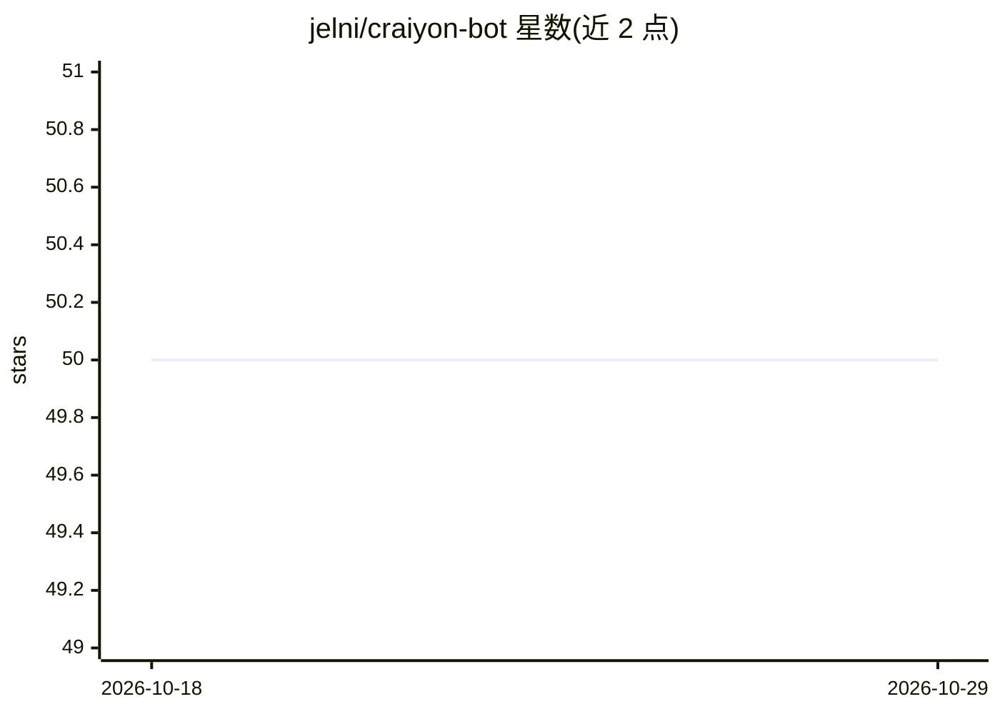

# jelni/craiyon-bot

⭐ 50 · Rust · AGPL-3.0 · 推送 2026-06-20 · [GitHub](https://github.com/jelni/craiyon-bot) · [官网](https://t.me/CraiyonArtBot) · 个人维护

**多用途 Telegram 机器人，提供文本与图像生成等命令**

用 Rust 编写的 Telegram 机器人，聚合多种命令：文本与图像生成（主题标签含 craiyon 与 stable-diffusion）及若干实用/娱乐命令。部署方式为克隆仓库、复制 .env.example 填写变量后以 docker compose up 运行；构建过程会先编译 TDLib，耗时较长。README 未提供命令清单细节或配置变量说明。

## 筛选速览

| 维度 | 判定 | 备注 |
|---|---|---|
| AI 角色 | `ai-native` | 本体是模型或模型工具 |
| 许可风险 | `viral` | AGPL-3.0 |
| 部署形态 | `self-host` | docker 或自建部署 |
| 模型依赖 | — | README 未给出锁定关系 |
| 硬件要求 | — | 无带数字的原话,不猜 |
| 安装摩擦 | `low` | 无编译、无系统依赖或容器化 |
| 成熟度 | — | 结构信号不足 |

## 能力要点

- Telegram 机器人形式的文本与图像生成命令
- 通过 Docker Compose 一键部署
- 基于 Rust 与 TDLib 构建

## 适用场景

- 在 Telegram 群组/对话中使用图像生成命令
- 自部署一个带生成能力的多用途机器人

## 场景标签

`图像生成` `聊天机器人` · 领域:对话与助手

## 证据(README 行号)

> L3: a multipurpose Telegram bot with various text and image generation, utility, and
> L4: other useless commands.

## 星数曲线

2026-10-18 50 → 2026-10-29 50（+0）

---
*卡片 v1 · prompt 1.4 · 生成 2026-10-24 · 置信度 mid · 依据 README sha `a486dab91498` · [字段定义](../../DATASET.md)*
