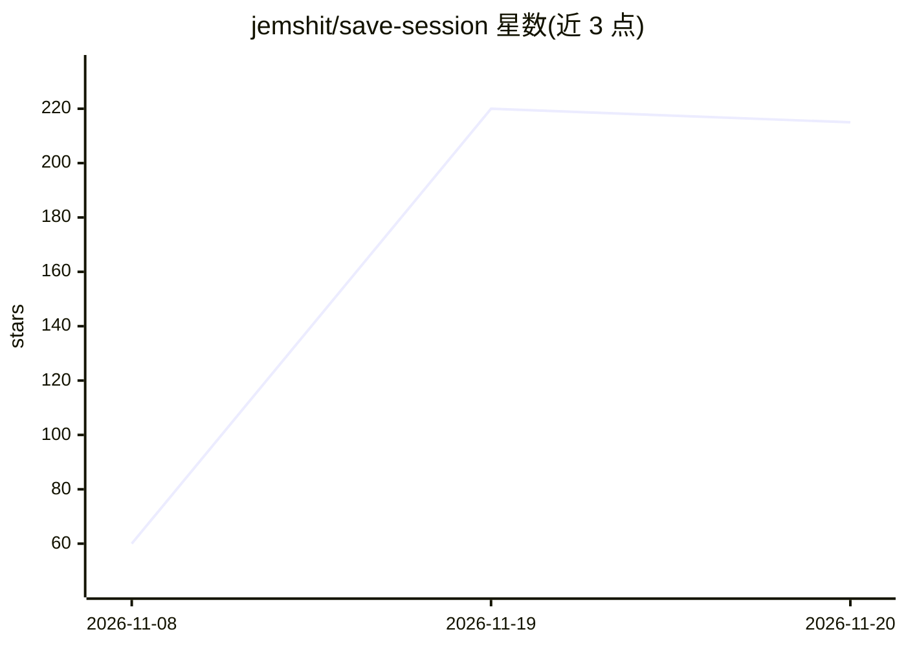

# jemshit/save-session

⭐ 215 · Python · MIT · 推送 2026-10-20 · [GitHub](https://github.com/jemshit/save-session) · 个人维护

**给 AI 编码代理用户：按项目名保存、查找并恢复会话的技能**

面向 Pi、Claude Code、Codex、Antigravity CLI、OpenCode 五种编码代理的会话管理技能：以项目标题为会话写书签，之后按名称查找并返回该 harness 原生的恢复命令与工作目录。保存时检测当前会话 id、模型与目录，检测不确定时会先询问；书签为本地纯文本 Markdown 文件，每个 harness 一份，存储于 ~/.agents/memories/sessions/，可通过环境变量改路径。查找操作只读。以 Agent Skills（npx skills add）、Claude Code 插件或 Pi install 方式安装。

## 筛选速览

| 维度 | 判定 | 备注 |
|---|---|---|
| AI 角色 | `ai-ecosystem` | LLM/agent 周边工具 |
| 许可风险 | `permissive` | MIT |
| 部署形态 | `library` | 以包/库形式分发 |
| 模型依赖 | — | README 未给出锁定关系 |
| 硬件要求 | — | 无带数字的原话,不猜 |
| 安装摩擦 | `low` | 无编译、无系统依赖或容器化 |
| 成熟度 | — | 结构信号不足 |

## 能力要点

- 同一技能覆盖五种编码代理 harness
- 按项目标题书签会话并返回原生恢复命令与工作目录
- 书签为本地人类可读 Markdown，无服务器/账号/托管数据库
- 检测不确定时先询问，避免误存或误恢复

## 适用场景

- 在多个编码代理工具间切换后找回有上下文的会话
- 按项目名称而非 opaque 会话 id 恢复会话
- 在正确目录下拿到各 harness 的原生恢复命令

## 场景标签

`Agent 记忆` · 领域:Agent 开发

## 证据(README 行号)

> L9: `save-session` gives every supported coding agent the same simple workflow: bookmark the session
> L21: - **One skill, five harnesses.** Use the same requests in Pi, Claude Code, Codex, Antigravity CLI,

## 星数曲线

2026-11-08 60 → 2026-11-20 215（+155）

---
*卡片 v1 · prompt 1.4 · 生成 2026-11-18 · 置信度 high · 依据 README sha `6780e67e2f40` · [字段定义](../../DATASET.md)*
