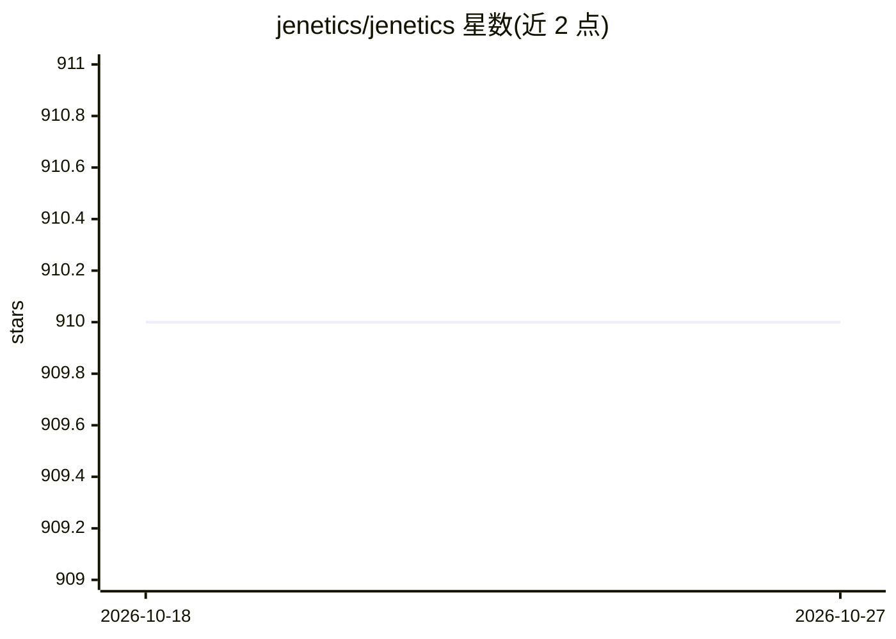

# jenetics/jenetics

⭐ 910 · Java · Apache-2.0 · 推送 2026-10-20 · [GitHub](https://github.com/jenetics/jenetics) · [官网](https://jenetics.io) · 组织维护

**Java 遗传算法/进化计算与多目标优化库**

用现代 Java 编写的进化计算库，覆盖遗传算法（GA）、进化算法（EA）、语法进化（GE）、遗传编程（GP）与多目标优化（MOEA）。以 Gene/Chromosome/Genotype/Phenotype 等概念分离设计，通过实现 Java Stream 接口的 EvolutionStream 执行进化步骤，可对给定适应度函数直接最小化/最大化。模块化发布到 Maven Central，要求 Java 25 编译运行，用 Gradle 从源码构建；另提供 .NET 实验移植（Jenetics.Net）与 Scala 封装（Helisa）。

## 筛选速览

| 维度 | 判定 | 备注 |
|---|---|---|
| AI 角色 | `ai-native` | 本体是模型或模型工具 |
| 许可风险 | `permissive` | Apache-2.0 |
| 部署形态 | `None` |  |
| 模型依赖 | — | README 未给出锁定关系 |
| 硬件要求 | — | 无带数字的原话,不猜 |
| 安装摩擦 | `medium` | 含编译或系统依赖之一 |
| 成熟度 | `idea` | |

## 能力要点

- 支持 GA、EA、GE、GP 与多目标优化（jenetics.ext 含 MOEA 与 GE）
- EvolutionStream 实现 Java Stream 接口，与 Stream API 集成
- 适应度函数无需修改即可最小化/最大化
- 核心与扩展模块发布到 Maven Central，附 Javadoc 与 PDF 用户手册

## 适用场景

- 在 Java 项目中求解组合优化与函数优化问题
- 用遗传编程做符号回归或程序演化
- 多目标优化问题的 MOEA 求解
- 学术研究中作为 GA/GP 实现基线（README 列出多篇引用论文）

## 场景标签

 · 领域:优化/进化计算

## 证据(README 行号)

> L7: **Jenetics** is a **Genetic Algorithm**, **Evolutionary Algorithm**, **Grammatical Evolution**, **Genetic Programmin
> L33: * **jenetics.ext** Javadoc: This module contains additional _non_-standard GA operations and data types. It also co

## 星数曲线

2026-10-18 910 → 2026-10-27 910（+0）

---
*卡片 v1 · prompt 1.4 · 生成 2026-10-21 · 置信度 high · 依据 README sha `332ebf816f1e` · [字段定义](../../DATASET.md)*
