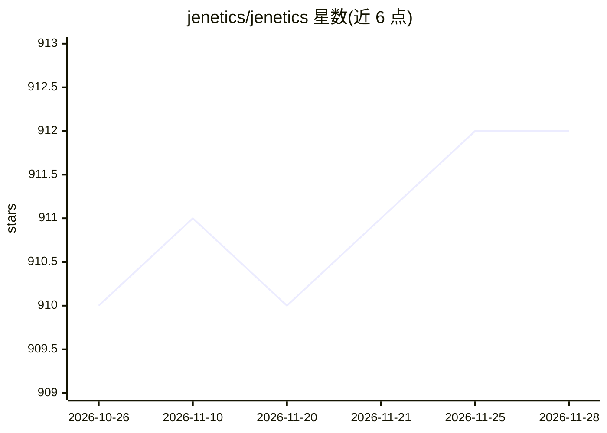

# jenetics/jenetics

⭐ 912 · Java · Apache-2.0 · 推送 2026-11-27 · [GitHub](https://github.com/jenetics/jenetics) · [官网](https://jenetics.io) · 个人维护 · 中文 README

**Java 遗传算法与多目标优化库，供开发者求解优化问题**

用现代 Java 编写的遗传算法、进化算法、文法进化、遗传编程与多目标优化库，核心概念（Gene、Chromosome、Genotype、Phenotype、Population、适应度函数）分离设计。通过 EvolutionStream 执行进化步骤，该流实现 Java Stream 接口，可与 Java Stream API 配合使用，适应度函数无需修改即可支持最小化与最大化。模块划分为 core、ext（多目标 MOEA 与文法进化）、prog（遗传编程）、xml（XML 序列化）。编译与运行至少需要 Java 25，使用 Gradle 构建，文档为 javadoc 与 PDF 用户手册。

## 筛选速览

| 维度 | 判定 | 备注 |
|---|---|---|
| AI 角色 | `ai-native` | 本体是模型或模型工具 |
| 许可风险 | `permissive` | Apache-2.0 |
| 部署形态 | `None` |  |
| 模型依赖 | — | README 未给出锁定关系 |
| 硬件要求 | — | 无带数字的原话,不猜 |
| 安装摩擦 | `medium` | 含编译或系统依赖之一 |
| 成熟度 | — | 结构信号不足 |

## 能力要点

- EvolutionStream 实现 Java Stream 接口，与 Stream API 无缝集成
- 模块化组织：core、ext（MOEA/GE）、prog（GP）、xml（序列化）
- 适应度函数支持最小化与最大化且无需改动函数本身
- Engine 可配置 alterer、selector 与 Executor 线程数

## 适用场景

- 在 Java 项目中实现遗传算法求解优化问题
- 做多目标优化（MOEA）或文法进化实验
- 用遗传编程做符号回归等程序进化任务

## 场景标签

 · 领域:算法库/优化与元启发式

## 证据(README 行号)

> L7: **Jenetics** is a **Genetic Algorithm**, **Evolutionary Algorithm**, **Grammatical Evolution**, **Genetic Programmin
> L20: **Jenetics** requires at least **Java 25** to compile and run.

## 星数曲线

2026-10-26 910 → 2026-11-28 912（+2）

---
*卡片 v1 · prompt 1.4 · 生成 2026-11-28 · 置信度 high · 依据 README sha `6b96b6f4169b` · [字段定义](../../DATASET.md)*
