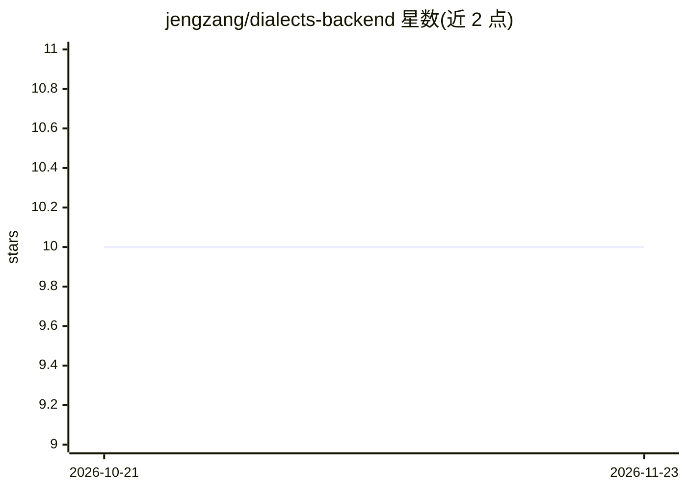

# jengzang/dialects-backend

⭐ 10 · Python · 推送 2026-11-11 · [GitHub](https://github.com/jengzang/dialects-backend) · [官网](https://dialects.yzup.top) · 个人维护 · 中文 README

**汉语方言地理语言学研究后端：提供读音查询、音系分析、声学与聚类 API**

「方音图鑑」的 FastAPI 后端，为前端与外部 API 客户端提供方言读音查询、跨地点比较、音系分析、词表管理、方言地图、Praat 声学分析及村名机器学习计算等服务。基于 SQLite 业务数据库与 SQLAlchemy，WEB 模式使用 Redis 缓存，通过 Gunicorn/Uvicorn 部署，Dockerfile 提供 FFmpeg 与 OpenMP 依赖。业务数据库与前端构建产物不随 Git 提交，需另行准备；工具分析结果按清理策略临时保留。

## 筛选速览

| 维度 | 判定 | 备注 |
|---|---|---|
| AI 角色 | `ai-enhanced` | 去掉 AI 部分产品仍成立 |
| 许可风险 | `none` | — |
| 部署形态 | `self-host` | docker 或自建部署 |
| 模型依赖 | — | README 未给出锁定关系 |
| 硬件要求 | — | 无带数字的原话,不猜 |
| 安装摩擦 | `low` | 无编译、无系统依赖或容器化 |
| 成熟度 | — | 结构信号不足 |

## 能力要点

- 多方言点查询与比较：查字、查中古、查调、桑基图音值对应
- Praat 声学分析工具：基频、共振峰、元音空间与基频定调（基于 praat-parselmouth）
- 方言聚类与 VillagesML 村名分析：分阶段计算接口与预计算结果查询
- 地图工作台：GeoJSON/KML 导入、泰森多边形生成与导出

## 适用场景

- 查询和比较多个地点的方言读音、声韵调系统
- 对方言音频做基频、共振峰等声学分析
- 构建方言分区地图并进行编辑导出
- 运行村名的字频、语义与空间机器学习分析

## 场景标签

`科研工具` · 领域:学习与行业

## 证据(README 行号)

> L3: 方音图鑑的 FastAPI 后端，为汉语方言读音查询、跨地点比较、音系分析、词句资料和地图工作台提供数据与计算服务。
> L87: 后端还提供方言聚类的任务与分阶段计算接口，可查看任务、距离和聚类结果；具体请求与配置见 API 参考及 Cluster 专题文档。
> L93: VillagesML 提供村名搜索、字频、语义、空间、N-gram 模式、区域比较、机器学习计算及系统信息。预计算结果查询与按请求运行的计算模块各有实现，不能将全部接口理解为仅查询离线结果。ML 计算需要登录。详见 Village

## 星数曲线

2026-10-21 10 → 2026-11-23 10（+0）

---
*卡片 v1 · prompt 1.4 · 生成 2026-11-19 · 置信度 high · 依据 README sha `1f61dee49175` · [字段定义](../../DATASET.md)*
