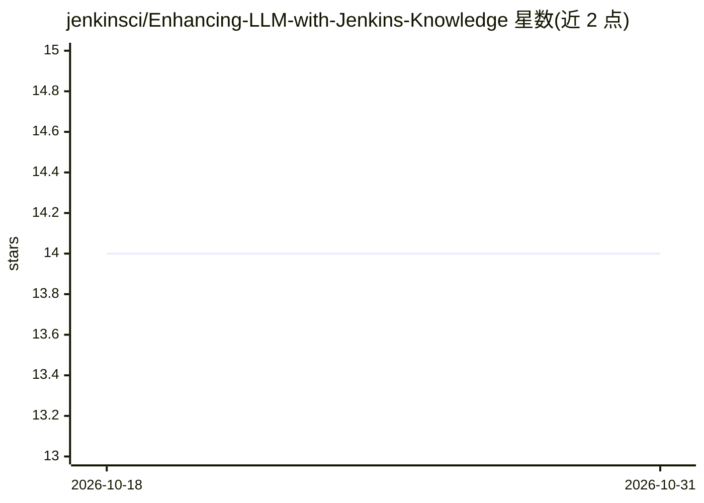

# jenkinsci/Enhancing-LLM-with-Jenkins-Knowledge

⭐ 14 · Jupyter Notebook · MIT · 推送 2026-08-28 · [GitHub](https://github.com/jenkinsci/Enhancing-LLM-with-Jenkins-Knowledge) · [官网](https://www.jenkins.io/blog/2024/05/01/google-summer-of-code-congrats-and-welcome/) · 组织维护

**基于 Llama2 微调的 Jenkins 领域问答聊天应用，可本地运行**

Google Summer of Code 2024 项目，用 Jenkins 领域数据对 Llama2 做本地微调并配 Web UI 供用户问答。后端 Flask 首次运行自动下载约 6GB 模型，前端 Vite/Node。提供 Colab 微调 notebook（T4 GPU、Lora 权重合并、可上传 Hugging Face），并通过 llama.cpp 将模型转换为 GGUF 格式，支持 CPU 运行与 q8_0 量化（量化后约 6.7GB）。

## 筛选速览

| 维度 | 判定 | 备注 |
|---|---|---|
| AI 角色 | `ai-native` | 本体是模型或模型工具 |
| 许可风险 | `permissive` | MIT |
| 部署形态 | `desktop` | 安装包/桌面程序 |
| 模型依赖 | local-ok | 支持本地模型 |
| 硬件要求 | — | 无带数字的原话,不猜 |
| 安装摩擦 | `medium` | 含编译或系统依赖之一 |
| 成熟度 | — | 结构信号不足 |

## 能力要点

- Llama2 在 Jenkins 领域数据上微调并配 Flask + Vite Web UI
- 首次运行自动下载约 6GB 模型到本地
- 提供 Colab 微调与 LoRA 合并、Hugging Face 上传 notebook
- 经 llama.cpp 转 GGUF，支持 CPU 运行与 q8_0 量化

## 适用场景

- 本地运行 Jenkins 领域问答聊天机器人
- 用自己的数据微调并发布自己的模型版本
- 将微调模型量化后在 CPU 上运行

## 场景标签

`聊天机器人` `微调` · 领域:对话与助手

## 证据(README 行号)

> L8:  This Project is from Google Summer of code 2024
> L68: - note that if you are running the BE server for the first time so it will download the model locally on your machi
> L74: - we fine-tune llama2 using colab free resources of T4 GPU with 16 GB VRAM

## 星数曲线

2026-10-18 14 → 2026-10-31 14（+0）

---
*卡片 v1 · prompt 1.4 · 生成 2026-10-31 · 置信度 high · 依据 README sha `8220f6495b1b` · [字段定义](../../DATASET.md)*
