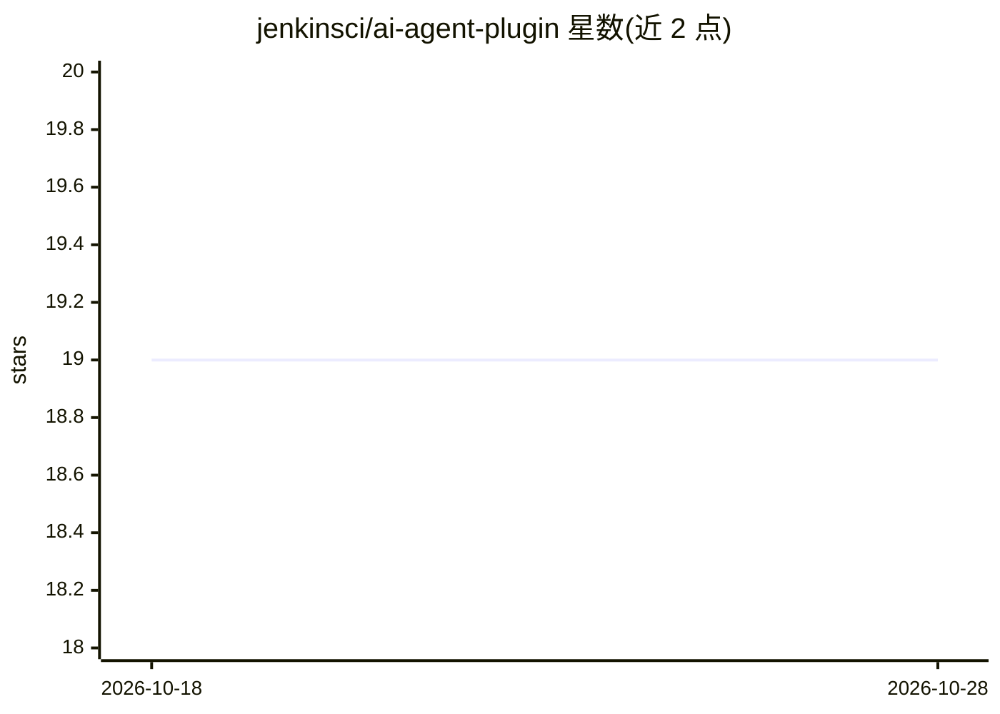

# jenkinsci/ai-agent-plugin

⭐ 19 · Java · MIT · 推送 2026-10-23 · [GitHub](https://github.com/jenkinsci/ai-agent-plugin) · [官网](https://plugins.jenkins.io/ai-agent/) · 组织维护

**Jenkins 插件：在 CI 任务中运行多种自主编码 Agent**

为 Jenkins 提供 Run AI Agent 可复用构建步骤，支持在 Freestyle 任务与 Pipeline 中运行 Claude Code、Codex CLI、Cursor Agent、OpenCode、Antigravity CLI、Grok Build、Pi、Oh My Pi、Kiro CLI 九种编码 Agent。插件解析各 Agent 的 JSON/stream-json 输出，在构建页实时流式展示对话、工具调用与 thinking 块，提取 token 与成本统计，支持人工审批门、YOLO 模式、模型与推理力度覆盖、setup 脚本及凭证注入。各 Agent 需在 Jenkins 节点单独安装（如 agy、Pi、OMP、Grok Build CLI）；已移除 Gemini CLI 处理器并要求迁移到 Antigravity CLI。通过 Jenkins 插件中心或 .hpi 文件安装。

## 筛选速览

| 维度 | 判定 | 备注 |
|---|---|---|
| AI 角色 | `ai-ecosystem` | LLM/agent 周边工具 |
| 许可风险 | `permissive` | MIT |
| 部署形态 | `library` | 以包/库形式分发 |
| 模型依赖 | locked-api |  |
| 硬件要求 | — | 无带数字的原话,不猜 |
| 安装摩擦 | `medium` | 含编译或系统依赖之一 |
| 成熟度 | — | 结构信号不足 |

## 能力要点

- Run AI Agent 构建步骤支持 9 种编码 Agent，Freestyle 与 Pipeline 均可使用
- 构建页实时流式展示对话、工具调用输入输出与 thinking 块，并渲染 Markdown
- 从 Agent 日志提取 token 数、成本与耗时按构建展示
- 可选人工审批门在工具执行前暂停构建等待审核

## 适用场景

- 在 Jenkins 流水线中让编码 Agent 执行代码审查、修复测试等任务
- 在构建页追踪 Agent 对话与 token/成本统计
- 通过审批门在 CI 中对 Agent 工具调用做人工把关

## 场景标签

`编码 Agent` `代码审查` · 领域:编码与开发

## 证据(README 行号)

> L7: A Jenkins plugin that adds a reusable **Run AI Agent** build step for running autonomous coding
> L15: - **Reusable build step** — add `Run AI Agent` to Freestyle jobs or Pipeline via `aiAgent(...)`.
> L16: - **Multiple agent support:** Claude Code, Codex CLI, Cursor Agent, OpenCode, Antigravity CLI,

## 星数曲线

2026-10-18 19 → 2026-10-28 19（+0）

---
*卡片 v1 · prompt 1.4 · 生成 2026-10-28 · 置信度 mid · 依据 README sha `617cab0d187b` · [字段定义](../../DATASET.md)*
