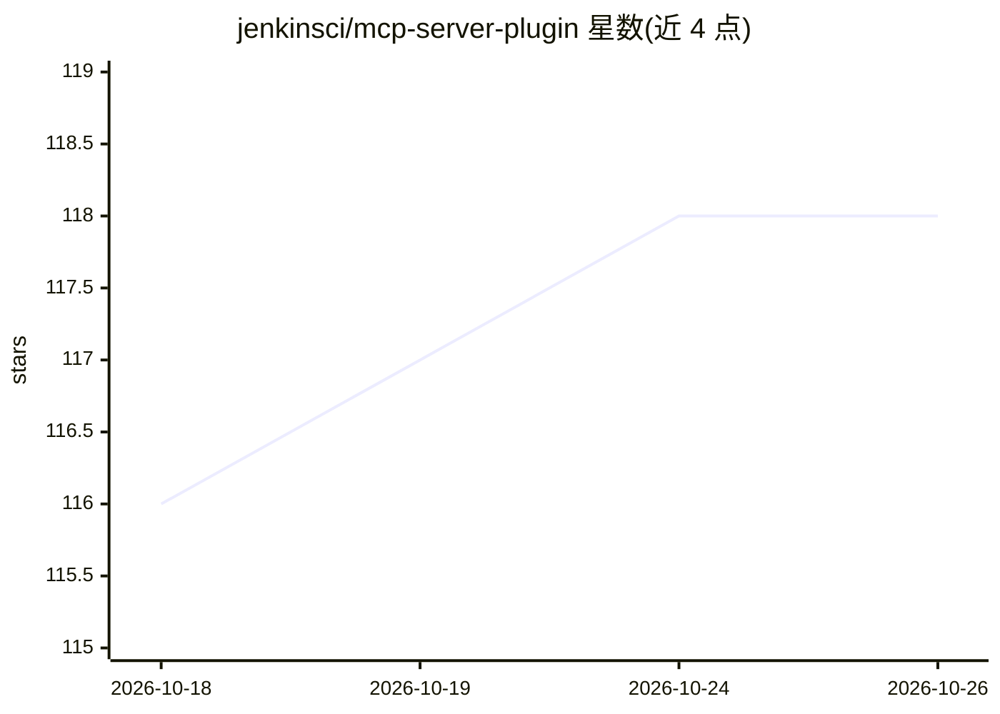

# jenkinsci/mcp-server-plugin

⭐ 118 · Java · MIT · 推送 2026-10-24 · [GitHub](https://github.com/jenkinsci/mcp-server-plugin) · [官网](https://plugins.jenkins.io/mcp-server/) · 组织维护

**让 Jenkins 作为 MCP 服务器向 AI 客户端提供工具与上下文的插件**

Jenkins 官方组织下的插件，基于 MCP Java SDK 0.17.2（规范 2025-06-18）实现 Model Context Protocol 服务端：安装后自动注册端点与默认工具集（含与 Jenkins jobs/builds 交互的工具），把 Jenkins 功能以 MCP tools/resources 形式暴露给 LLM 应用或 IDE；可通过 McpServerExtension 接口扩展新工具。提供 SSE、Streamable HTTP、Stateless 三种传输端点（可分别禁用），带 keep-alive、健康检查、指标与优雅停机机制，认证沿用 Jenkins API Token + Basic Auth。README 给出 Cline、Copilot、Windsurf、Cursor、Claude 等客户端配置示例。

## 筛选速览

| 维度 | 判定 | 备注 |
|---|---|---|
| AI 角色 | `ai-ecosystem` | LLM/agent 周边工具 |
| 许可风险 | `permissive` | MIT |
| 部署形态 | `None` |  |
| 模型依赖 | — | README 未给出锁定关系 |
| 硬件要求 | — | 无带数字的原话,不猜 |
| 安装摩擦 | `low` | 无编译、无系统依赖或容器化 |
| 成熟度 | — | 结构信号不足 |

## 能力要点

- Jenkins 功能暴露为 MCP tools/resources，支持 McpServerExtension 扩展
- 三种传输端点（SSE / Streamable HTTP / Stateless）可独立启停
- keep-alive、健康检查端点、指标端点与优雅停机等连接可靠性机制
- Origin 头校验与 CSRF crumb 等安全配置项

## 适用场景

- 让 IDE 中的 AI 助手通过 MCP 触发和查询 Jenkins 构建任务
- 为 LLM 应用接入 CI/CD 上下文与工具
- 通过无会话端点在简化部署或测试场景中调用 Jenkins 工具

## 场景标签

 · 领域:开发工具/CI-CD

## 证据(README 行号)

> L2: The MCP (Model Context Protocol) Server Plugin for Jenkins implements the server-side component of the Model Context
> L7: - **Jenkins Integration**: Exposes Jenkins functionalities as MCP tools and resources.

## 星数曲线

2026-10-18 116 → 2026-10-26 118（+2）

---
*卡片 v1 · prompt 1.4 · 生成 2026-10-23 · 置信度 high · 依据 README sha `eae21779cc30` · [字段定义](../../DATASET.md)*
