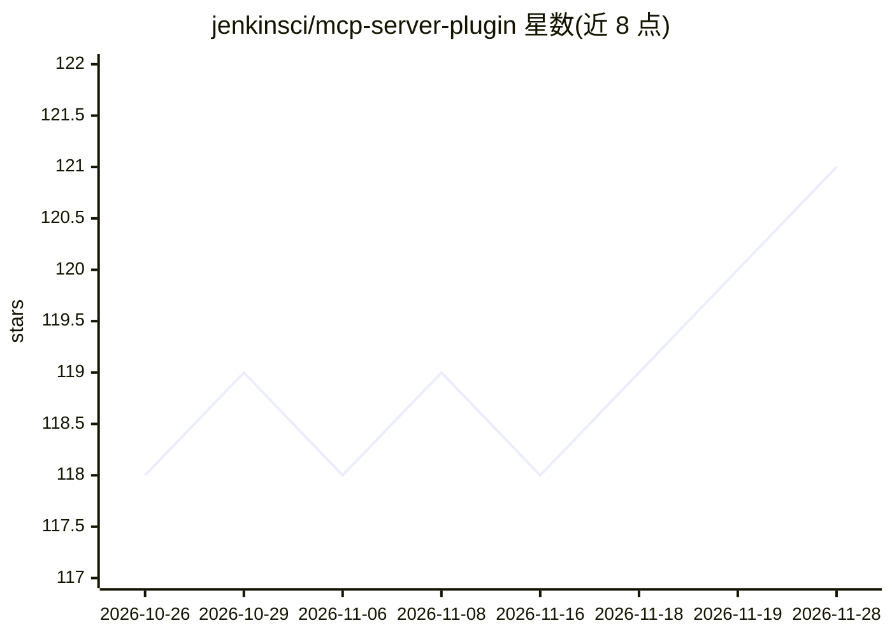

# jenkinsci/mcp-server-plugin

⭐ 121 · Java · MIT · 推送 2026-11-26 · [GitHub](https://github.com/jenkinsci/mcp-server-plugin) · [官网](https://plugins.jenkins.io/mcp-server/) · 组织维护

**让 Jenkins 作为 MCP 服务器向 AI 客户端暴露 CI 工具的插件**

Jenkins 的 MCP Server 插件，实现 Model Context Protocol 服务端，将 Jenkins 的任务与构建操作以 MCP 工具和资源形式暴露给 LLM 应用或 IDE 等客户端。安装后自动配置端点，默认提供任务/构建交互工具与构建日志搜索，支持 SSE、Streamable HTTP、Stateless 三种传输，可通过 McpServerExtension 接口扩展。提供健康检查与指标端点、会话清理、优雅关闭，并给出 CSRF、Origin 校验与正则开销等安全与性能配置项。

## 筛选速览

| 维度 | 判定 | 备注 |
|---|---|---|
| AI 角色 | `ai-ecosystem` | LLM/agent 周边工具 |
| 许可风险 | `permissive` | MIT |
| 部署形态 | `None` |  |
| 模型依赖 | — | README 未给出锁定关系 |
| 硬件要求 | — | 无带数字的原话,不猜 |
| 安装摩擦 | `low` | 无编译、无系统依赖或容器化 |
| 成熟度 | — | 结构信号不足 |

## 能力要点

- 安装即用：自动建立 MCP 端点与默认工具，无需额外配置
- 三种传输端点（SSE/Streamable HTTP/Stateless）可独立启停
- 提供 /mcp-health 健康端点与连接指标端点，支持优雅关闭与空闲会话回收
- 基于 MCP Java SDK 0.17.2（MCP 规范 2025-06-18），可经 McpServerExtension 扩展

## 适用场景

- 让 AI 客户端通过 MCP 查询构建状态与搜索构建日志
- 在 IDE 中的 AI 助手里触发和管理 Jenkins 构建
- 为 CI 系统构建代理化运维与自动化诊断流程

## 场景标签

 · 领域:开发工具/CI-CD 集成

## 证据(README 行号)

> L2: The MCP (Model Context Protocol) Server Plugin for Jenkins implements the server-side component of the Model Context
> L7: - **Jenkins Integration**: Exposes Jenkins functionalities as MCP tools and resources.
> L157: For better connection reliability, we recommend using **Streamable HTTP** (`/mcp-server/mcp`) instead of **SSE** (

## 星数曲线

2026-10-26 118 → 2026-11-28 121（+3）

---
*卡片 v1 · prompt 1.4 · 生成 2026-11-28 · 置信度 high · 依据 README sha `cf9c734427ca` · [字段定义](../../DATASET.md)*
