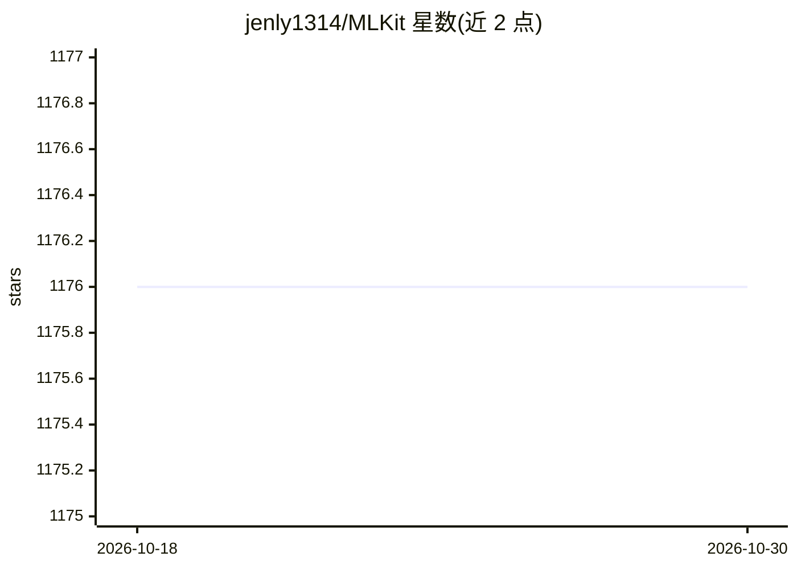

# jenly1314/MLKit

⭐ 1,176 · Kotlin · Apache-2.0 · 推送 2026-06-11 · [GitHub](https://github.com/jenly1314/MLKit) · [官网](https://jenly1314.github.io/MLKit/) · 个人维护 · 中文 README

**Android 端 Google ML Kit 机器视觉功能的封装工具库**

面向 Android 开发者的 ML Kit 封装库：将谷歌 ML Kit 的文字识别、条码识别（含多种线性与 2D 格式）、人脸检测、人脸网格、图像标签、对象检测、姿势检测、自拍分割等能力封装为 CameraScan 基础上的 Analyzer 与 CameraScanActivity/Fragment 子类，开发者继承对应类即可实现扫描检测。2.x 版本以独立维护的 CameraScan 作为相机核心库，另支持通过 TensorFlow Lite 使用自定义模型，模型可经 Google Play Services 下载。通过 Gradle 引入，v2.4.0+ 要求 compileSdk ≥ 35，编译需 JDK 8+。

## 筛选速览

| 维度 | 判定 | 备注 |
|---|---|---|
| AI 角色 | `ai-ecosystem` | LLM/agent 周边工具 |
| 许可风险 | `permissive` | Apache-2.0 |
| 部署形态 | `None` |  |
| 模型依赖 | — | README 未给出锁定关系 |
| 硬件要求 | — | 无带数字的原话,不猜 |
| 安装摩擦 | `medium` | 含编译或系统依赖之一 |
| 成熟度 | — | 结构信号不足 |

## 能力要点

- 覆盖 9 类视觉子模块：条码/人脸/网格/标签/对象/姿势/自拍分割/文字识别
- 各子模块提供 Analyzer 与 BaseCameraScanActivity/Fragment 子类快速实现
- 支持 TensorFlow Lite 自定义模型接入
- 模型可配置通过 Google Play Services 下载

## 适用场景

- 在 Android 应用中快速集成扫码或文字识别功能
- 实现基于相机预览的人脸/对象/姿势实时检测
- 使用自定义 TensorFlow Lite 模型做图像分析

## 场景标签

`人脸识别` `目标检测` `OCR` · 领域:感知与多模态

## 证据(README 行号)

> L10: ML Kit是一个能够将谷歌专业的机器学习知识带到应用中的极其简单易用的封装包。无论您是否有机器学习的经验，您都可以在几行代码中实现您想要的功能。甚至，您无需对神经网络或者模型优化有多深入的了解，也能完成您想要做的事情。
> L12: 基于现有的API您可以很轻松的实现文字识别、条码识别、图像标签、人脸检测、对象检测等功能；另一方面，如果您是一位经验丰富的ML开发人员，ML Kit甚至提供了便利的API，可帮助您在移动应用中使用自定义的TensorFlow Li

## 星数曲线

2026-10-18 1,176 → 2026-10-30 1,176（+0）

---
*卡片 v1 · prompt 1.4 · 生成 2026-10-21 · 置信度 mid · 依据 README sha `ba2edfbb6eba` · [字段定义](../../DATASET.md)*
