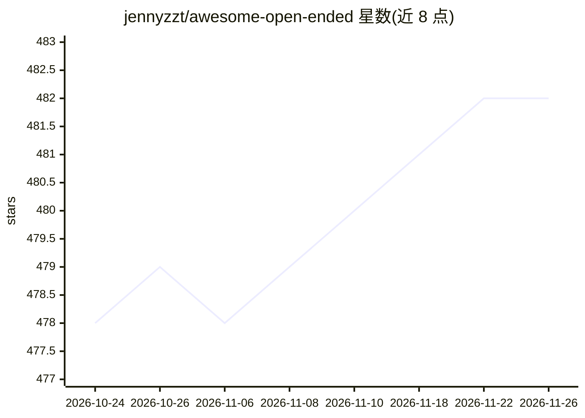

# jennyzzt/awesome-open-ended

⭐ 482 · 推送 2026-11-21 · [GitHub](https://github.com/jennyzzt/awesome-open-ended) · 个人维护

**面向研究者的开放式学习 AI 论文与项目资源清单**

策展型资源清单：收录开放式学习方向的论文条目，每条按发表时间排序，包含标题、作者、会议/年份及论文、代码、网站链接；主题覆盖环境生成、强化学习、具身智能体、演化计算等。README 定义开放式算法为持续发明并解决日益复杂任务的研究方向。清单接受社区通过 pull request 贡献新条目，并提供统一的条目格式模板。

## 筛选速览

| 维度 | 判定 | 备注 |
|---|---|---|
| AI 角色 | `ai-knowledge` | 知识聚合/清单类 |
| 许可风险 | `none` | — |
| 部署形态 | `None` |  |
| 模型依赖 | — | README 未给出锁定关系 |
| 硬件要求 | — | 无带数字的原话,不猜 |
| 安装摩擦 | `low` | 无编译、无系统依赖或容器化 |
| 成熟度 | — | 结构信号不足 |

## 能力要点

- 按发表时间排序收录开放式学习方向论文
- 每条目附带论文、代码、网站链接
- 提供社区贡献格式模板，接受 pull request

## 适用场景

- 查找开放式强化学习方向的入门论文
- 检索环境生成与智能体研究的开源代码实现
- 按时间线了解该方向论文脉络

## 场景标签

`精选清单` · 领域:学习与行业

## 证据(README 行号)

> L2: A curated list of open-ended learning AI resources. The aim of open-ended algorithms is to keep on inventing new and
> L14: ## Papers

## 星数曲线

2026-10-24 478 → 2026-11-26 482（+4）

---
*卡片 v1 · prompt 1.4 · 生成 2026-11-25 · 置信度 high · 依据 README sha `02e630326051` · [字段定义](../../DATASET.md)*
