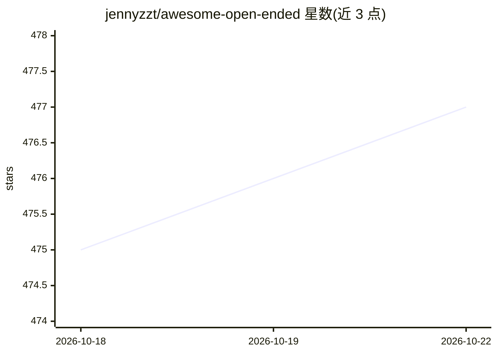

# jennyzzt/awesome-open-ended

⭐ 478 · 推送 2026-10-21 · [GitHub](https://github.com/jennyzzt/awesome-open-ended) · 个人维护

**开放式学习（open-ended）AI 研究论文与资源策展清单**

由个人维护的 awesome 类策展清单，收录开放式学习/开放式进化方向的学术论文与资源，主题为 AI 如何持续发明并解决越来越复杂的新任务。条目按发表年份排序，覆盖 2008–2023 年约 40 篇论文，涉及 POET、无监督环境设计、MiniHack、MineDojo、Voyager、Promptbreeder、STOP 等工作，每条含论文链接，多数附代码库或网站链接。README 给出贡献格式说明，接受 pull request；无安装或运行内容，纯阅读型资源。

## 筛选速览

| 维度 | 判定 | 备注 |
|---|---|---|
| AI 角色 | `ai-knowledge` | 知识聚合/清单类 |
| 许可风险 | `none` | — |
| 部署形态 | `None` |  |
| 模型依赖 | — | README 未给出锁定关系 |
| 硬件要求 | — | 无带数字的原话,不猜 |
| 安装摩擦 | `low` | 无编译、无系统依赖或容器化 |
| 成熟度 | — | 结构信号不足 |

## 能力要点

- 收录 2008–2023 年开放式学习/开放式进化领域论文
- 每条含 Paper 链接，多数附 Code/Website/Demo 链接
- 条目按发表时间排序，覆盖环境设计、涌现课程、自我改进等方向

## 适用场景

- 查阅开放式学习领域的论文脉络与代表性工作
- 按论文条目找到对应的开源代码库复现实验
- 通过 pull request 补充该方向的新论文资源

## 场景标签

`精选清单` · 领域:学习与行业

## 证据(README 行号)

> L2: A curated list of open-ended learning AI resources. The aim of open-ended algorithms is to keep on inventing new and
> L7: We warmly welcome contributions! If you know of a paper, project, or resource related to open-endedness that isn’t l

## 星数曲线

2026-10-18 475 → 2026-10-22 477（+2）

---
*卡片 v1 · prompt 1.4 · 生成 2026-10-21 · 置信度 high · 依据 README sha `86e0b1267295` · [字段定义](../../DATASET.md)*
