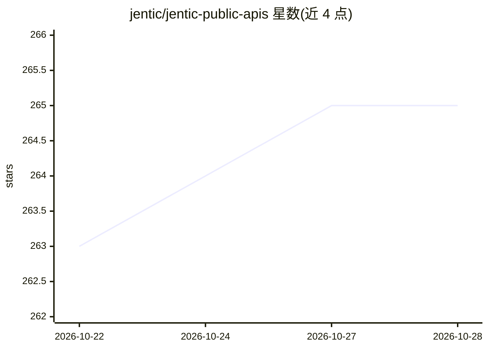

# jentic/jentic-public-apis

⭐ 267 · CC0-1.0 · 推送 2026-10-28 · [GitHub](https://github.com/jentic/jentic-public-apis) · [官网](https://jentic.com/) · 组织维护

**面向 AI agent 的公开 API 知识目录：数千个 OpenAPI 规格与 AI 就绪评分**

Jentic 维护的公开 API 目录仓库：收录数千个 API 的机器可读 OpenAPI 规格，按 22 个类别组织，多数规格附带 scorecard.json 的 AI 就绪评分；另含 AI 生成的 Arazzo 工作流（跨 API 组合操作）、结构化仓库规范与贡献流程。仓库内容以 CC0 发布，项目自述处于 ALPHA 阶段。配套工具包括 Jentic One 执行层（自托管，CLI 与 MCP 两种接入方式，凭证经 Broker 注入）与 npm 分发的 API Scorecard 评分 CLI。

## 筛选速览

| 维度 | 判定 | 备注 |
|---|---|---|
| AI 角色 | `ai-knowledge` | 知识聚合/清单类 |
| 许可风险 | `viral` | CC0-1.0 |
| 部署形态 | `library` | 以包/库形式分发 |
| 模型依赖 | — | README 未给出锁定关系 |
| 硬件要求 | — | 无带数字的原话,不猜 |
| 安装摩擦 | `low` | 无编译、无系统依赖或容器化 |
| 成熟度 | `idea` | |

## 能力要点

- 数千个 API 的机器可读 OpenAPI 规格，22 个类别组织
- scorecard.json 存储 AI 就绪评分，可离线读取
- Arazzo 工作流描述跨一个或多个 API 的组合操作
- Jentic One 执行层：CLI 与 MCP（stdio/HTTP）接入，凭证注入不经手 agent

## 适用场景

- 为 AI agent 查找并读取目标 API 的结构化规格
- 评估某 API 的文档对 AI 的可用程度（就绪评分）
- 发现可跨多个 API 编排的 Arazzo 工作流

## 场景标签

`精选清单` · 领域:学习与行业

## 证据(README 行号)

> L118: AI agents depend on APIs. Their capabilities are defined by the APIs they know about, and their reliability is def
> L135: 1. Standardized OpenAPI specifications for public APIs

## 星数曲线

2026-10-22 263 → 2026-10-28 265（+2）

---
*卡片 v1 · prompt 1.4 · 生成 2026-10-22 · 置信度 mid · 依据 README sha `83064ecc3f4c` · [字段定义](../../DATASET.md)*
