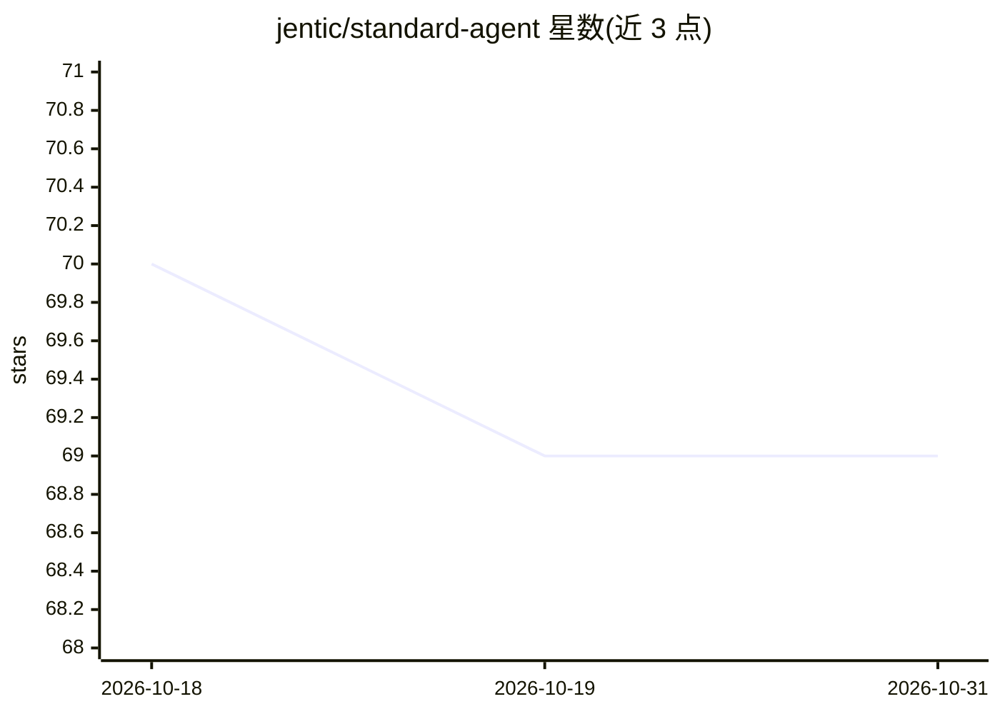

# jentic/standard-agent

⭐ 69 · Python · Apache-2.0 · 推送 2026-06-12 · [GitHub](https://github.com/jentic/standard-agent) · 组织维护

**可组合 AI Agent 推理库：可替换 LLM、推理策略、记忆与工具**

Python 编写的模块化 Agent 构建库，提供连接 LLM 与工具的核心推理循环，LLM、推理策略（ReWOO/ReACT）、记忆后端、工具提供方均可替换组合。倡导 just-in-time 工具加载范式，运行时按任务动态加载工具。附示例 CLI，但系统提示词、工具集与 UI 一般需自备。安装方式为 git clone 源码，需配置 .env 中的 LLM API key，可选 Jentic API key 获取 1500+ API 工具。非完整带 UI 的 Agent 产品。

## 筛选速览

| 维度 | 判定 | 备注 |
|---|---|---|
| AI 角色 | `ai-ecosystem` | LLM/agent 周边工具 |
| 许可风险 | `permissive` | Apache-2.0 |
| 部署形态 | `None` |  |
| 模型依赖 | — | README 未给出锁定关系 |
| 硬件要求 | — | 无带数字的原话,不猜 |
| 安装摩擦 | `low` | 无编译、无系统依赖或容器化 |
| 成熟度 | — | 结构信号不足 |

## 能力要点

- 可替换组件架构：LLM/推理策略/记忆/工具提供方均可互换
- 内置 ReWOO（计划→执行→反思）与 ReACT 两种推理策略
- just-in-time 工具加载，运行时动态绑定工具
- 可选 OpenTelemetry 可观测性，支持 OTLP 后端导出

## 适用场景

- 快速搭建自定义 Agent，跳过样板代码专注业务逻辑
- 对比与评估不同推理策略的效果
- 基于统一接口扩展新的推理策略或工具提供方

## 场景标签

`Agent 框架` · 领域:Agent 开发

## 证据(README 行号)

> L13: *Standard Agent* is a simple, modular library for building AI agents, with a composable core and plug‑in components
> L15: It is *not* a complete agent with a nice user interface. It is a library that provides the core agent reasoning loo
> L84: *Standard Agent* provides a composable architecture that allows you to swap out different LLMs, reasoning strategie

## 星数曲线

2026-10-18 70 → 2026-10-31 69（-1）

---
*卡片 v1 · prompt 1.4 · 生成 2026-10-24 · 置信度 high · 依据 README sha `d9490737f7b4` · [字段定义](../../DATASET.md)*
