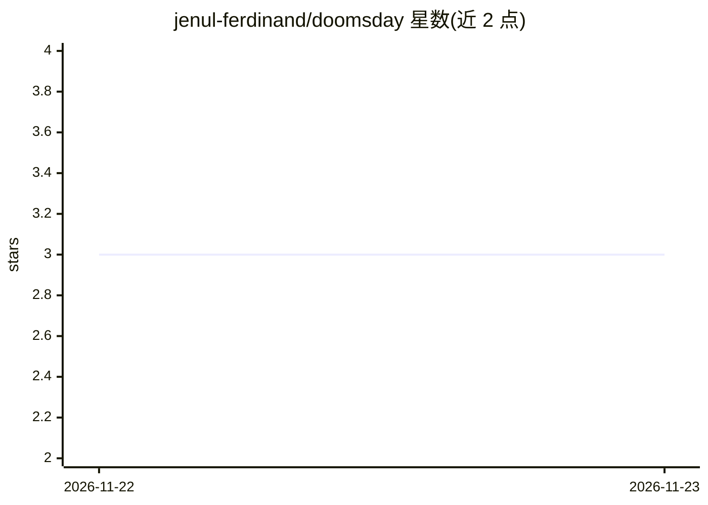

# jenul-ferdinand/doomsday

⭐ 3 · Shell · 推送 2026-10-27 · [GitHub](https://github.com/jenul-ferdinand/doomsday) · 个人维护

**核爆求生指南与离线资料/本地 AI/网状网络工具栈**

包含两部分：8 篇核攻击及其后果的生存指南（准备、爆炸、掩蔽、去污、医疗、通信、善后、地区差异），以及一个可在断网环境运行的离线栈——通过 git 子模块与 setup.sh 下载约 130 GB 数据，包括英文维基百科 ZIM 镜像（kiwix-serve 托管）、llama.cpp 在 CPU 上运行 Gemma 模型并提供聊天页面、Internet-in-a-Box 树莓派热点、Meshtastic LoRa 消息固件与 Reticulum 加密组网。README 注明 AI 在剂量、药物与数字方面易出错，需对照指南核验。

## 筛选速览

| 维度 | 判定 | 备注 |
|---|---|---|
| AI 角色 | `ai-enhanced` | 去掉 AI 部分产品仍成立 |
| 许可风险 | `none` | — |
| 部署形态 | `None` |  |
| 模型依赖 | local-ok | 支持本地模型 |
| 硬件要求 | — | 无带数字的原话,不猜 |
| 安装摩擦 | `medium` | 含编译或系统依赖之一 |
| 成熟度 | — | 结构信号不足 |

## 能力要点

- 离线栈集成 kiwix、llama.cpp、Internet-in-a-Box、Meshtastic、Reticulum 五类模块
- setup.sh 支持断点续传与跳过已完成下载，需联网时预先执行
- llama.cpp 在普通 CPU 上运行 Gemma 模型并托管本地聊天页面
- 指南来源包括 FEMA、CDC、REMM、WHO 等官方文件

## 适用场景

- 断网或灾后环境下离线查阅维基百科与维修手册
- 本地运行无需互联网的 AI 问答
- 用 LoRa 无线电在无网络区域收发文本消息
- 打印纸质核爆应对指南随身携带

## 场景标签

`AI 助手` · 领域:对话与助手

## 证据(README 行号)

> L3:  Guides for surviving a nuclear attack and its aftermath, and an offline stack (all of Wikipedia, a local AI, mesh n
> L45: |Local AI|llama.cpp: runs open models on a plain CPU and serves a chat page|Gemma 4 E4B (4.6 GB, needs 8 GB RAM)|
> L46: |Local internet|iiab: Internet-in-a-Box turns a Raspberry Pi into an offline Wi-Fi hotspot with Wikipedia, maps and

## 星数曲线

2026-11-22 3 → 2026-11-23 3（+0）

---
*卡片 v1 · prompt 1.4 · 生成 2026-11-22 · 置信度 high · 依据 README sha `d1346427c04e` · [字段定义](../../DATASET.md)*
