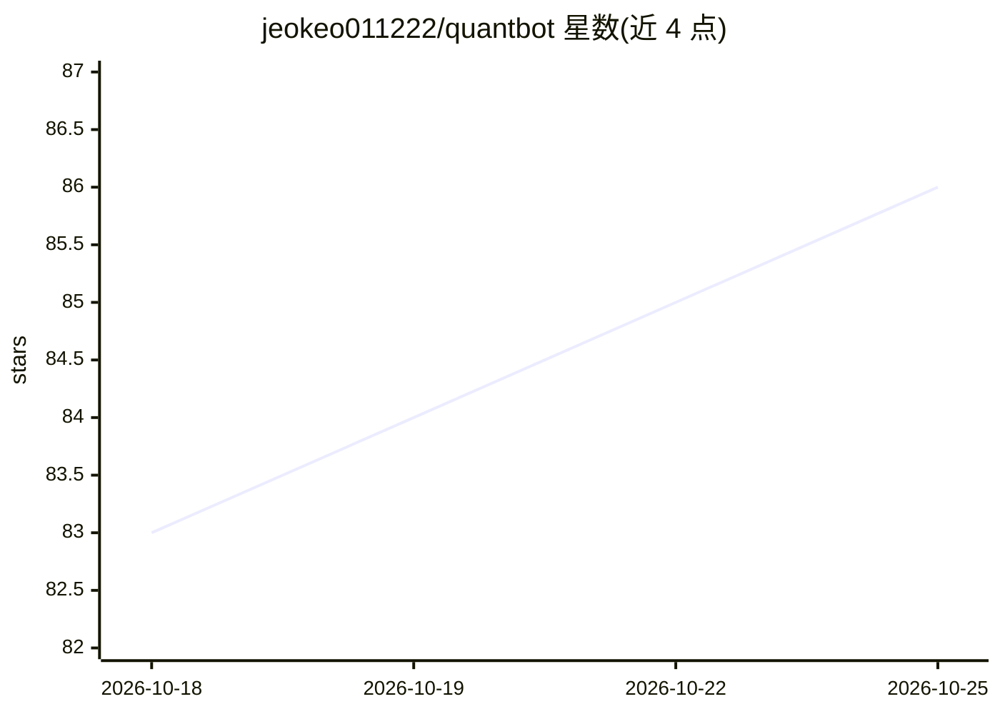

# jeokeo011222/quantbot

⭐ 86 · Go · NOASSERTION · 推送 2026-10-16 · [GitHub](https://github.com/jeokeo011222/quantbot) · 个人维护 · 中文 README

**A股量化交易桌面系统：AI 智能体协作完成选股、决策与交易**

基于 Go+React+Wails 构建的 Windows 本地量化交易软件，面向 A 股投资者：5 个 AI Agent（Planner/Quant/Risk/CIO/Trader）组成投资决策链，结合多因子选股、17 种内置策略、回测、六维判势与三层风控（含 CIO 建仓硬门控、回撤熔断）。AI 使用用户自有 API Key，LLM 失败可回退规则决策。数据来自通达信/腾讯财经/同花顺等并存储于本地 SQLite+DuckDB。v1.8.0 决策脑合并为单 exe。声明仅供学习研究，不构成投资建议。

## 筛选速览

| 维度 | 判定 | 备注 |
|---|---|---|
| AI 角色 | `ai-native` | 本体是模型或模型工具 |
| 许可风险 | `none` | NOASSERTION |
| 部署形态 | `desktop` | 安装包/桌面程序 |
| 模型依赖 | — | README 未给出锁定关系 |
| 硬件要求 | — | 无带数字的原话,不猜 |
| 安装摩擦 | `low` | 无编译、无系统依赖或容器化 |
| 成熟度 | — | 结构信号不足 |

## 能力要点

- 5 个 AI Agent 协作决策链（Planner→Quant→Risk→CIO→Trader）
- 多因子选股 + 分半稳定性检验 + 17 种内置策略回测
- 三层风控：规则门、AI 评审、熔断与建仓硬门控
- v1.8.0 单 exe 部署（~74 MB），零 CGO/syscall

## 适用场景

- 每天自动跑盘前决策、盘中监控、盘后复盘的量化工作流
- 用多因子与策略回测筛选和管理 A 股持仓组合
- 研究 AI Agent 与量化引擎结合的投资决策系统

## 场景标签

`多智能体` `金融量化` · 领域:Agent 开发

## 证据(README 行号)

> L59: QuantBot 当前采用多个 AI Agent 协作完成投资工作。
> L161: 投资方案 -> 量化筛选 -> 因子分析 -> 策略分析 -> 风险分析 -> 组合分析 -> AI Agent 协作 -> 投资决策
> L253: - 🔑 AI 服务使用你自己的 API Key，成本可控

## 星数曲线

2026-10-18 83 → 2026-10-25 86（+3）

---
*卡片 v1 · prompt 1.4 · 生成 2026-10-24 · 置信度 high · 依据 README sha `70ad418d35b9` · [字段定义](../../DATASET.md)*
