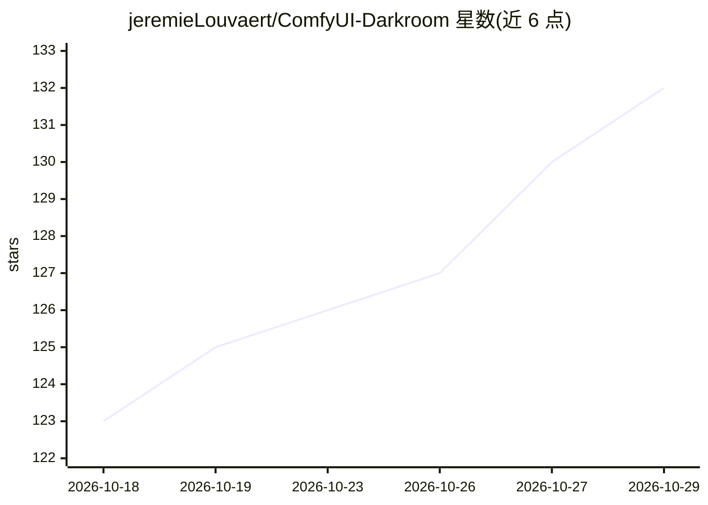

# jeremieLouvaert/ComfyUI-Darkroom

⭐ 132 · Python · 推送 2026-10-05 · [GitHub](https://github.com/jeremieLouvaert/ComfyUI-Darkroom) · 个人维护

**ComfyUI 调色与胶片模拟节点套件：59 个节点、161 种胶片**

面向 ComfyUI 的自定义节点集，提供 59 个节点覆盖胶片模拟（14 个节点：胶片边框、漏光、损伤、颗粒、光晕、倒易律失效等 161 种彩色/黑白胶片，其中 56 种来自 Capture One Film Styles 的曲线数据）、Camera Raw 处理、达芬奇风格的调色工具（Lift Gamma Gain、Log Wheels、OkLab 等）、镜头光学模拟与 102 个镜头配置文件。全部本地运行、无 API 费用，多数节点基于物理模型与厂商数据表，纯 numpy 实现而非训练模型。

## 筛选速览

| 维度 | 判定 | 备注 |
|---|---|---|
| AI 角色 | `ai-ecosystem` | LLM/agent 周边工具 |
| 许可风险 | `none` | — |
| 部署形态 | `library` | 以包/库形式分发 |
| 模型依赖 | — | README 未给出锁定关系 |
| 硬件要求 | `cpu-ok` | |
| 安装摩擦 | `low` | 无编译、无系统依赖或容器化 |
| 成熟度 | — | 结构信号不足 |

## 能力要点

- 161 种胶片模拟，56 种含 Capture One 曲线数据（匹配至约 1/255）
- 物理推导的颗粒、光晕、倒易律失效等胶片效应，分辨率无关
- 达芬奇 Resolve 风格调色工具集与 ACES 色彩管理、LUT 导出
- 全程本地运行，无 API 费用，无外部依赖

## 适用场景

- 在 ComfyUI 工作流中为生成或实拍图像做胶片风格化
- 完成从底片到相纸的完整胶片链路模拟与输出
- 进行 Camera Raw 级别的白平衡、曝光与局部调色
- 模拟漏光、划痕、暗角等光学与胶片损伤效果

## 场景标签

`图像视频处理` · 领域:感知与多模态

## 证据(README 行号)

> L1: # ComfyUI-Darkroom
> L5: Color grading and film emulation for ComfyUI: 59 nodes, 161 film stocks, 35 spectral neg×print LUTs, 102 lens profil
> L7: The most complete color toolset in the ComfyUI ecosystem: physics-based film emulation, DaVinci Resolve-level color 

## 星数曲线

2026-10-18 123 → 2026-10-29 132（+9）

---
*卡片 v1 · prompt 1.4 · 生成 2026-10-23 · 置信度 mid · 依据 README sha `622a220bc2e6` · [字段定义](../../DATASET.md)*
