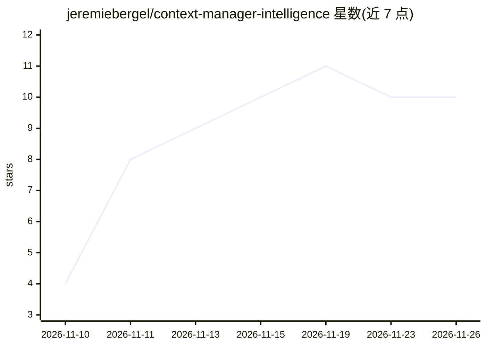

# jeremiebergel/context-manager-intelligence

⭐ 10 · Python · MIT · 推送 2026-11-17 · [GitHub](https://github.com/jeremiebergel/context-manager-intelligence) · 个人维护

**本地代理：压缩编码 agent 上下文，延长订阅用量降低 API 账单**

一个运行在本地（127.0.0.1）的零 LLM 上下文引擎与代理，位于 Claude Code、Codex 等编码 agent 与 AI 服务之间：把旧的对话内容折叠为短摘要并保留 recall key，AI 需要时通过 cmi_recall 取回逐字节一致的原文。采用确定性规则而非额外 AI 判断，每请求约 20 ms 开销；按 provider 缓存定价权衡是否重写缓存，30 请求后才开始折叠。作者实测 26 个真实会话平均减少约 30% 发送 token、模型化 API 成本约 −25%。Windows 为预览状态。

## 筛选速览

| 维度 | 判定 | 备注 |
|---|---|---|
| AI 角色 | `ai-ecosystem` | LLM/agent 周边工具 |
| 许可风险 | `permissive` | MIT |
| 部署形态 | `None` |  |
| 模型依赖 | — | README 未给出锁定关系 |
| 硬件要求 | — | 无带数字的原话,不猜 |
| 安装摩擦 | `low` | 无编译、无系统依赖或容器化 |
| 成熟度 | — | 结构信号不足 |

## 能力要点

- 无损折叠旧上下文：摘要+recall key，原文可逐字节取回
- 零 LLM 调用、零网络遥测，纯本地规则引擎，约 20 ms/请求
- 按 provider 缓存规则计价，仅在重写可回本时折叠
- 跨模型项目记忆（实验性，Hermes Agent 中可用）

## 适用场景

- 让 Claude Pro/Max 或 ChatGPT/Codex 订阅在相同限额下完成更多工作
- 按 token 计费时降低长会话的 API 成本
- 多个 AI 工具（Cline、Aider 等）通过改 base URL 接入同一代理

## 场景标签

`Agent 记忆` · 领域:Agent 开发

## 证据(README 行号)

> L26: CMI sits between you and the AI and **folds the old pages**. Recent work stays open. Old things become a
> L68: Claude Code (terminal and VS Code), Codex and Hermes Agent: yes, tested. Other assistants that let you
> L87: Local, deterministic, zero-LLM, about 20 ms per request. Nothing is lost: every shortened result comes back byte-ex

## 星数曲线

2026-11-10 4 → 2026-11-26 10（+6）

---
*卡片 v1 · prompt 1.4 · 生成 2026-11-19 · 置信度 high · 依据 README sha `14224e7c6ec1` · [字段定义](../../DATASET.md)*
