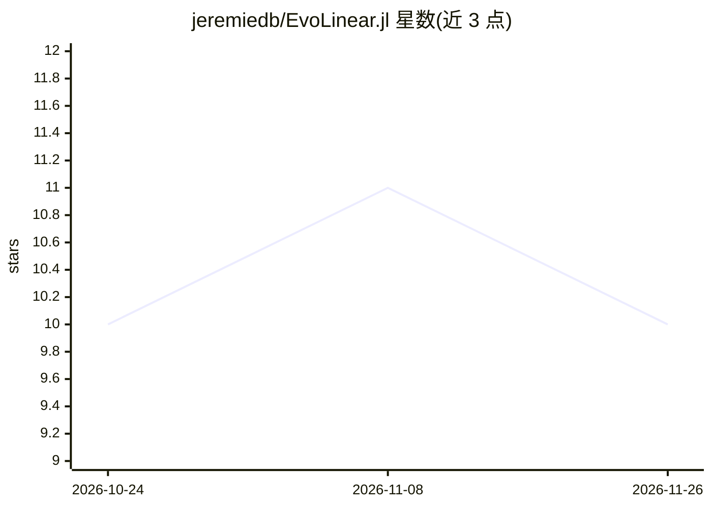

# jeremiedb/EvoLinear.jl

⭐ 10 · Julia · MIT · 推送 2026-03-01 · [GitHub](https://github.com/jeremiedb/EvoLinear.jl) · [官网](https://jeremiedb.github.io/EvoLinear.jl/dev/) · 个人维护

**Julia 线性 boosting 机器学习库**

实现带 L1/L2 正则化的线性 boosting 的 Julia 机器学习库，支持 mse 回归、logloss 逻辑回归及 poisson/gamma/tweedie 损失函数。模型通过 EvoLinearRegressor 定义超参数，fit 函数可训练 Tables 兼容对象上的模型，支持指定特征、目标与可选权重变量。从 General Registry 或 GitHub 源码安装。README 提示树模型 boosting 可参考同作者的 EvoTrees.jl。

## 筛选速览

| 维度 | 判定 | 备注 |
|---|---|---|
| AI 角色 | `ai-native` | 本体是模型或模型工具 |
| 许可风险 | `permissive` | MIT |
| 部署形态 | `None` |  |
| 模型依赖 | — | README 未给出锁定关系 |
| 硬件要求 | — | 无带数字的原话,不猜 |
| 安装摩擦 | `low` | 无编译、无系统依赖或容器化 |
| 成熟度 | — | 结构信号不足 |

## 能力要点

- 线性 boosting 支持 L1 与 L2 正则化
- 支持 mse/logloss/poisson/gamma/tweedie 等损失函数
- fit 接口支持 Tables 兼容数据与可选权重变量
- 可从 Julia General Registry 直接安装

## 适用场景

- 在 Julia 中训练带正则化的线性回归/分类模型
- 处理需要 poisson/gamma/tweedie 损失的保险或计数数据建模
- 与 EvoTrees.jl 配合分别做线性与树模型 boosting

## 场景标签

 · 领域:机器学习/统计建模

## 证据(README 行号)

> L7: ML library implementing linear boosting with L1 and L2 regularization.
> L12: - `mse`: mean squared-error regression

## 星数曲线

2026-10-24 10 → 2026-11-26 10（+0）

---
*卡片 v1 · prompt 1.4 · 生成 2026-11-18 · 置信度 high · 依据 README sha `017ac7f90738` · [字段定义](../../DATASET.md)*
