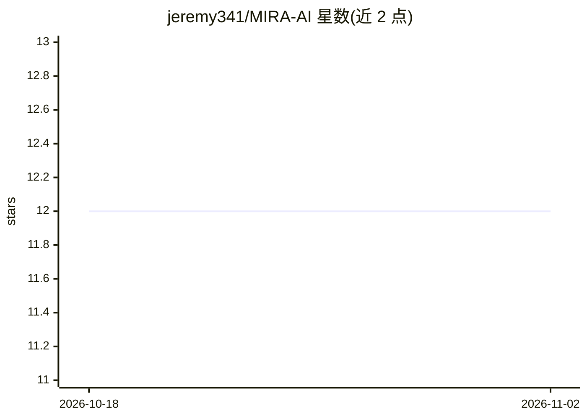

# jeremy341/MIRA-AI

⭐ 12 · Python · MIT · 推送 2026-10-27 · [GitHub](https://github.com/jeremy341/MIRA-AI) · [官网](mira-vision.vercel.app) · 个人维护

**基于 YOLO11n 的废弃物检测管线：识别玻璃/金属/纸/塑料/垃圾**

面向垃圾分类场景的计算机视觉项目：训练并对比多个检测模型（自定义 CNN、MobileNetV2、YOLOv8n、YOLO11n），在清洗后的数据集上记录实验结果（EXP-018/019 验证集 mAP50 约 90.6%）。以 PyPI 包 mira-ai 发布，内置模型权重，支持摄像头实时推理、本地开发面板、数据集与评测工具，并可导出 ONNX/TFLite。限制：指标来自录制评测环境，模型对皱纸、易拉罐开口视角、重叠物体等场景存在困难；配套分拣机器人尚未完成。

## 筛选速览

| 维度 | 判定 | 备注 |
|---|---|---|
| AI 角色 | `ai-native` | 本体是模型或模型工具 |
| 许可风险 | `permissive` | MIT |
| 部署形态 | `library` | 以包/库形式分发 |
| 模型依赖 | — | README 未给出锁定关系 |
| 硬件要求 | — | 无带数字的原话,不猜 |
| 安装摩擦 | `low` | 无编译、无系统依赖或容器化 |
| 成熟度 | `idea` | |

## 能力要点

- 检测玻璃、金属、纸、塑料、垃圾五类废弃物
- 摄像头实时推理与本地开发面板
- 提供数据集与评测工具，实验历史可查
- 模型可导出 ONNX 与 TFLite 格式

## 适用场景

- 用摄像头实时识别废弃物类别
- 复现和比较废弃物检测实验结果
- 将检测模型导出到 ONNX/TFLite 用于其他部署环境

## 场景标签

`目标检测` · 领域:感知与多模态

## 证据(README 行号)

> L15: |EXP-018|YOLO11n|415-image validation split|90.6%|
> L57: - Detects glass, metal, paper, plastic, and trash
> L58: - Runs live webcam inference

## 星数曲线

2026-10-18 12 → 2026-11-02 12（+0）

---
*卡片 v1 · prompt 1.4 · 生成 2026-11-01 · 置信度 high · 依据 README sha `1bb9efbbfc80` · [字段定义](../../DATASET.md)*
