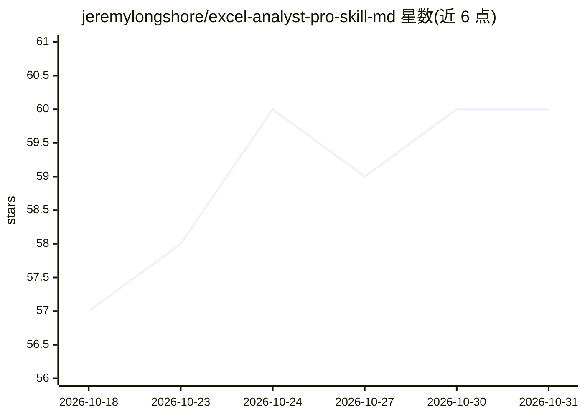

# jeremylongshore/excel-analyst-pro-skill-md

⭐ 60 · Python · NOASSERTION · 推送 2026-10-14 · [GitHub](https://github.com/jeremylongshore/excel-analyst-pro-skill-md) · [官网](https://claudecodeplugins.io) · 组织维护

**给 Claude Code 的金融建模技能包：自然语言生成 DCF/LBO/方差分析 Excel**

面向 Claude Code 等 AgentSkills 兼容框架的技能插件，将用户提供的财务证据转化为可复核的 Excel 工作簿，覆盖 DCF 估值、LBO 回报分析、预算/预测/期间方差分析三类任务。工作流区分给定事实与假设、公式链接到输入单元格、保存后由表格引擎重算并复核关键单元格；只读校验器检查证据内部一致性。原生透视表/图表等不支持的对象不承诺，缺失证据不会被编造替代。含 v1.1 多技能向单一入口的迁移表；源码许可为 Intent Solutions 专有。

## 筛选速览

| 维度 | 判定 | 备注 |
|---|---|---|
| AI 角色 | `ai-ecosystem` | LLM/agent 周边工具 |
| 许可风险 | `none` | NOASSERTION |
| 部署形态 | `library` | 以包/库形式分发 |
| 模型依赖 | locked-api |  |
| 硬件要求 | — | 无带数字的原话,不猜 |
| 安装摩擦 | `low` | 无编译、无系统依赖或容器化 |
| 成熟度 | — | 结构信号不足 |

## 能力要点

- DCF/LBO/方差分析三类工作簿生成，假设显式标注并链接公式
- 保存后重算并复核关键单元格的验证流程，附证据与验证回执
- 单一 SKILL.md 入口，兼容 Codex 等 AgentSkills 框架；工作流本身不调用模型 API
- 可选 MCP 适配器示例（excel-mcp-server）与仅用 Python 标准库的校验辅助脚本

## 适用场景

- 用自然语言让 Claude Code 搭建 DCF/LBO 或预算方差分析工作簿
- 把给定财务证据转为可审计、假设可追踪的 Excel 模型
- 在 Codex 等 AgentSkills 兼容环境中复用同一建模技能

## 场景标签

`金融量化` · 领域:学习与行业

## 证据(README 行号)

> L51: The plugin includes one model-neutral AgentSkills.io entrypoint at
> L56: The Claude plugin does **not** start or download an MCP server automatically. An

## 星数曲线

2026-10-18 57 → 2026-10-31 60（+3）

---
*卡片 v1 · prompt 1.4 · 生成 2026-10-24 · 置信度 mid · 依据 README sha `b547f739f91e` · [字段定义](../../DATASET.md)*
