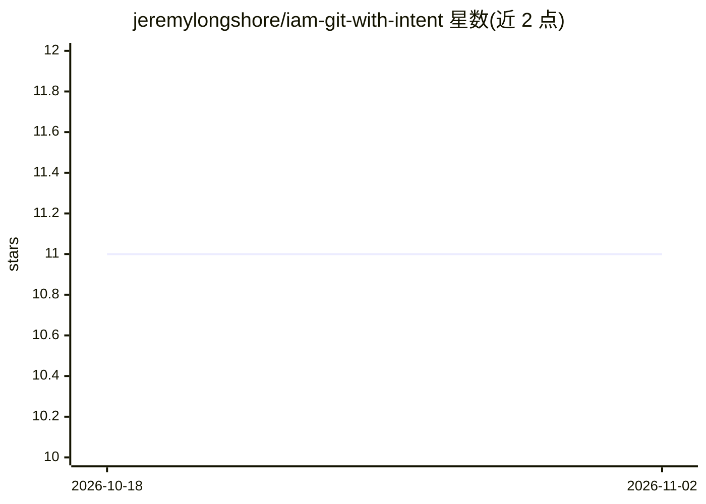

# jeremylongshore/iam-git-with-intent

⭐ 11 · TypeScript · NOASSERTION · 推送 2026-10-26 · [GitHub](https://github.com/jeremylongshore/iam-git-with-intent) · [官网](https://jeremylongshore.github.io/iam-git-with-intent/) · 组织维护

**AI 驱动的 git/PR 自动化 CLI，生成提交与 PR 并解决冲突**

面向开发者的命令行工具（gwi），基于 LLM 分析 diff 与 issue 完成 PR 工作流自动化：复杂度评分、语义化合并冲突解决、PR 审查摘要、issue 转代码生成 PR、triage→resolve→review→commit 的 autopilot 流水线。按任务复杂度路由到不同模型（Gemini Flash / Claude Sonnet / Claude Opus），破坏性操作需 SHA256 哈希绑定的显式批准，全程写入不可变审计日志。以 BSL 1.1 许可发布，部署含 5 个 Cloud Run 服务与 MCP 工具服务器。

## 筛选速览

| 维度 | 判定 | 备注 |
|---|---|---|
| AI 角色 | `ai-native` | 本体是模型或模型工具 |
| 许可风险 | `none` | NOASSERTION |
| 部署形态 | `library` | 以包/库形式分发 |
| 模型依赖 | locked-api |  |
| 硬件要求 | — | 无带数字的原话,不猜 |
| 安装摩擦 | `low` | 无编译、无系统依赖或容器化 |
| 成熟度 | — | 结构信号不足 |

## 能力要点

- 按复杂度路由多模型（Gemini Flash / Claude Sonnet / Claude Opus）
- 语义化合并冲突解决与 issue 转 PR 生成
- SHA256 哈希绑定的批准门控，补丁变更即批准失效
- 每次运行产出完整工件（plan/patch/review/audit.log）

## 适用场景

- 给 PR 做复杂度评分并生成审查摘要
- 让 AI 从 GitHub issue 直接生成代码与 PR
- 自动解决合并冲突并跑完整的 PR 流水线

## 场景标签

`代码生成` `编码 Agent` · 领域:编码与开发

## 证据(README 行号)

> L13: AI-powered CLI for PR automation. Semantic merge conflict resolution, issue-to-code generation, complexity scoring,
> L38: export ANTHROPIC_API_KEY="..."    # or GOOGLE_AI_API_KEY / OPENAI_API_KEY
> L76: |1–3|Gemini Flash|Fast scoring, simple triage|

## 星数曲线

2026-10-18 11 → 2026-11-02 11（+0）

---
*卡片 v1 · prompt 1.4 · 生成 2026-11-02 · 置信度 high · 依据 README sha `f976fecfa654` · [字段定义](../../DATASET.md)*
