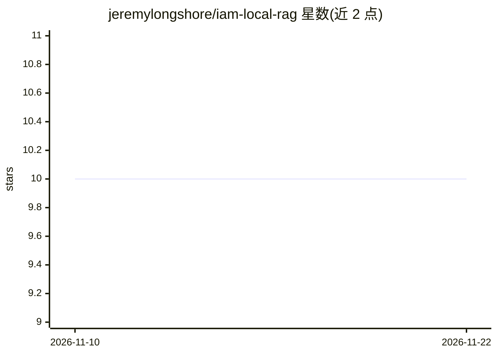

# jeremylongshore/iam-local-rag

⭐ 10 · Python · NOASSERTION · 推送 2026-10-14 · [GitHub](https://github.com/jeremylongshore/iam-local-rag) · 组织维护

**本地优先的可审计 RAG 问答系统：私有文档查询与隐私审计**

把本地文档转为可查询知识库的 RAG 系统，默认使用 Ollama + Chroma 全本地运行；可选通过 BYOK 接入 Anthropic、OpenAI、Vertex 等云端模型。每次出站调用经统一策略门控，local 模式零外呼；每条查询生成隐私收据，审计账本可验证篡改；内置评估工具度量召回率、引用覆盖率、拒答与注入抵抗等指标。提供 CLI、FastAPI 服务与 Streamlit UI，需 Python 3.11+。

## 筛选速览

| 维度 | 判定 | 备注 |
|---|---|---|
| AI 角色 | `ai-native` | 本体是模型或模型工具 |
| 许可风险 | `none` | NOASSERTION |
| 部署形态 | `None` |  |
| 模型依赖 | local-ok | 支持本地模型 |
| 硬件要求 | — | 无带数字的原话,不猜 |
| 安装摩擦 | `low` | 无编译、无系统依赖或容器化 |
| 成熟度 | — | 结构信号不足 |

## 能力要点

- local/hybrid/cloud 三模式，每次出站调用经统一策略门控
- 可验证引用与代码级拒答（证据不足时不作答）
- 每查询输出隐私收据 + hash 链式审计账本（nexus audit verify）
- 内置评估工具：召回、引用覆盖、接地性、隐私泄漏、注入抵抗

## 适用场景

- 在本地对私有文档做问答，数据不出机器
- 需要每条回答可溯源、可审计的知识库场景
- 混合模式下仅向云端发送脱敏片段

## 场景标签

`RAG` `文档问答` · 领域:知识与检索

## 证据(README 行号)

> L18: NEXUS turns your documents into a queryable knowledge base you control. It runs
> L34: - **One policy gate on every outbound call** (LLM *and* embeddings). `local` mode
> L45: - **It measures itself** — a built-in eval harness scores recall, citation

## 星数曲线

2026-11-10 10 → 2026-11-22 10（+0）

---
*卡片 v1 · prompt 1.4 · 生成 2026-11-19 · 置信度 high · 依据 README sha `747c5bf94d97` · [字段定义](../../DATASET.md)*
