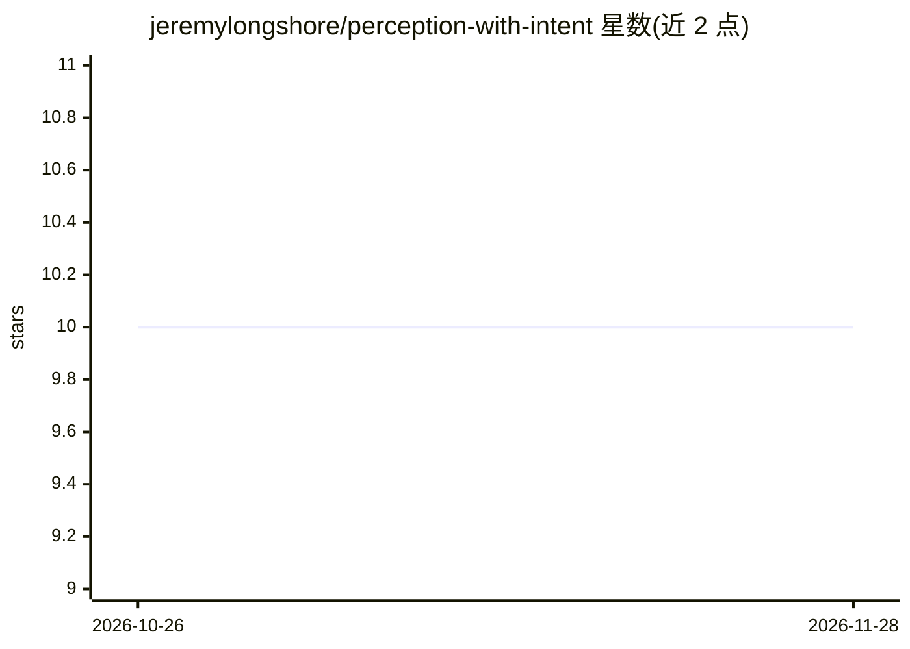

# jeremylongshore/perception-with-intent

⭐ 10 · Python · NOASSERTION · 推送 2026-10-14 · [GitHub](https://github.com/jeremylongshore/perception-with-intent) · [官网](http://perception-with-intent.web.app/) · 组织维护

**多智能体新闻情报系统：监控信源并生成高管级简报**

基于 Google Cloud 的多智能体新闻情报系统示例：8 个专用 Vertex AI 代理经 A2A 协议编排，从 RSS/API/自定义连接器采集新闻，由 Gemini 2.0 Flash 生成摘要、提取洞察并识别战略影响，结果写入 Firestore 并通过 React 仪表盘与每日高管简报呈现，支持 Slack/邮件/webhook 告警。部署依赖 GCP（Cloud Run、Terraform、GitHub Actions WIF）；README 注明 Agent Engine 部署与仪表盘数据接入仍处于待完成状态，月度运行成本约 $70。

## 筛选速览

| 维度 | 判定 | 备注 |
|---|---|---|
| AI 角色 | `ai-native` | 本体是模型或模型工具 |
| 许可风险 | `none` | NOASSERTION |
| 部署形态 | `library` | 以包/库形式分发 |
| 模型依赖 | — | README 未给出锁定关系 |
| 硬件要求 | — | 无带数字的原话,不猜 |
| 安装摩擦 | `low` | 无编译、无系统依赖或容器化 |
| 成熟度 | `idea` | |

## 能力要点

- 8 个专用 AI 代理经 A2A 协议在 Vertex AI Agent Engine 上编排
- Gemini 2.0 Flash 自动生成摘要与战略洞察
- RSS/API/自定义连接器的无锁定信源接入
- Firebase + Firestore 实时仪表盘与每日简报

## 适用场景

- 替代每天人工浏览数十个新闻信源的晨间例行工作
- 情报团队自动化竞品与市场信号监控
- 评估 Google ADK 在生产环境多智能体架构中的用法

## 场景标签

`多智能体` · 领域:Agent 开发

## 证据(README 行号)

> L9: Stop manually checking 50 news sources every morning. Perception monitors everything, filters what matters using 8 s
> L20: - 8 specialized AI agents coordinated via A2A Protocol
> L101: Perception uses 8 specialized AI agents orchestrated via Google's A2A Protocol on Vertex AI Agent Engine.

## 星数曲线

2026-10-26 10 → 2026-11-28 10（+0）

---
*卡片 v1 · prompt 1.4 · 生成 2026-11-19 · 置信度 mid · 依据 README sha `36b5588d6bce` · [字段定义](../../DATASET.md)*
