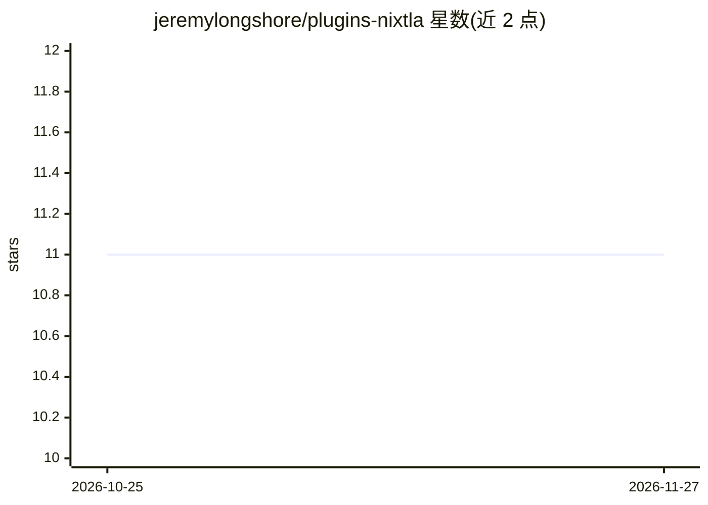

# jeremylongshore/plugins-nixtla

⭐ 11 · Python · NOASSERTION · 推送 2026-10-14 · [GitHub](https://github.com/jeremylongshore/plugins-nixtla) · [官网](https://jeremylongshore.github.io/claude-code-plugins-nixtla/) · 组织维护

**为 Claude Code 提供 Nixtla 时间序列预测插件与技能集**

面向 Claude Code 的插件与 Agent Skills 集合：包含 19 个插件（13 个达到 v1.0/v1.0-poc，6 个 WIP 脚手架）和 30 个技能，封装 Nixtla 的 statsforecast、mlforecast、neuralforecast 与 TimeGPT。入口插件 nixtla-baseline-lab 可离线运行基线预测，无需 API key；TimeGPT 相关功能需设置 NIXTLA_TIMEGPT_API_KEY。提供 skills.sh CLI 安装、pip 安装的技能安装器、pytest 测试与 CI 门禁，另附 ERCOT 电网预测原型工作区。

## 筛选速览

| 维度 | 判定 | 备注 |
|---|---|---|
| AI 角色 | `ai-ecosystem` | LLM/agent 周边工具 |
| 许可风险 | `none` | NOASSERTION |
| 部署形态 | `library` | 以包/库形式分发 |
| 模型依赖 | locked-api |  |
| 硬件要求 | — | 无带数字的原话,不猜 |
| 安装摩擦 | `low` | 无编译、无系统依赖或容器化 |
| 成熟度 | — | 结构信号不足 |

## 能力要点

- 19 个 Claude Code 插件 + 30 个 AI skills，覆盖 Nixtla 四个预测库
- baseline-lab 插件离线运行，无需 API key，约 90 秒完成
- 提供 pip 安装的 nixtla-skills 技能安装器（init/update）
- per-plugin CI 校验与 Plugin Validator v7.0 验证

## 适用场景

- 在 Claude Code 中对时间序列数据运行统计/ML/神经预测基线
- 通过 BigQuery 插件对云数据做预测并部署到 Cloud Functions
- 为团队项目批量安装与更新 Nixtla 预测相关 agent skills

## 场景标签

`数据分析` · 领域:效率与自动化

## 证据(README 行号)

> L7: Claude Code plugins and AI skills for time-series forecasting with Nixtla's statsforecast, mlforecast, neuralforecas
> L37: |**What**|19 Claude Code plugins + 30 AI skills for time-series forecasting|

## 星数曲线

2026-10-25 11 → 2026-11-27 11（+0）

---
*卡片 v1 · prompt 1.4 · 生成 2026-11-18 · 置信度 high · 依据 README sha `892640655821` · [字段定义](../../DATASET.md)*
