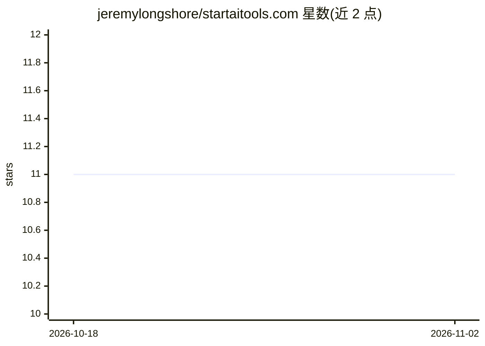

# jeremylongshore/startaitools.com

⭐ 11 · Python · MIT · 推送 2026-11-01 · [GitHub](https://github.com/jeremylongshore/startaitools.com) · [官网](https://startaitools.com) · 组织维护

**AI 部署技术博客与知识中心（Hugo 静态站点）**

由 Intent Solutions 维护的 Hugo 静态站点源码，内容为 AI 部署、数据工程与 DevOps 方向的 325+ 篇技术文章、实施案例研究与 AI 工程学习资源。使用 Archie 主题，构建经 minify 优化，通过 GitHub Actions 部署到自托管 VPS 并以 Caddy 提供服务，Hugo 版本固定为 0.150.0。面向关注 AI 实施的读者与投稿作者，本地开发需 Hugo v0.150.0+、Git 与 Node.js v18+。

## 筛选速览

| 维度 | 判定 | 备注 |
|---|---|---|
| AI 角色 | `ai-knowledge` | 知识聚合/清单类 |
| 许可风险 | `permissive` | MIT |
| 部署形态 | `None` |  |
| 模型依赖 | — | README 未给出锁定关系 |
| 硬件要求 | — | 无带数字的原话,不猜 |
| 安装摩擦 | `low` | 无编译、无系统依赖或容器化 |
| 成熟度 | — | 结构信号不足 |

## 能力要点

- 325+ 篇 AI 部署、数据工程与 DevOps 技术文章
- 含 DiagnosticPro 等实施案例研究与 AI 工程课程资源
- GitHub Actions 验证版本后原子发布到 VPS（Caddy，固定 Hugo 0.150.0）

## 适用场景

- 查阅 AI 部署与数据工程的技术指南和案例
- 按 AI 工程课程资源学习实施路径
- 作为 Hugo 博客部署流程的参考工程

## 场景标签

`教程课程` · 领域:学习与行业

## 证据(README 行号)

> L14: > Business blog and knowledge center for AI deployment, technical guides, and real-world implementation case studie
> L20: - 📝 **Technical Blog** - 325+ posts on AI deployment, data engineering, and DevOps
> L22: - 📊 **AI Engineering Resources** - Comprehensive curriculum and research materials

## 星数曲线

2026-10-18 11 → 2026-11-02 11（+0）

---
*卡片 v1 · prompt 1.4 · 生成 2026-11-02 · 置信度 high · 依据 README sha `f67657073c6e` · [字段定义](../../DATASET.md)*
