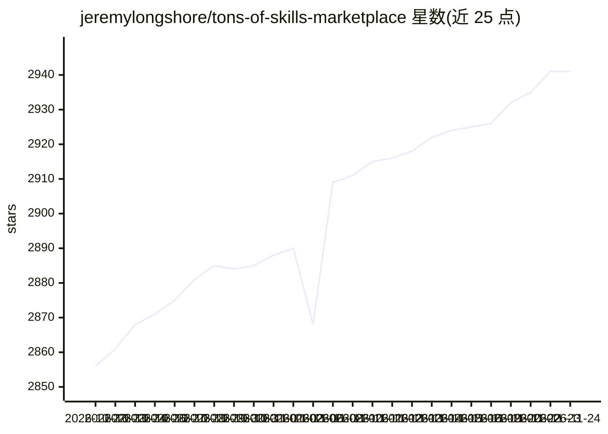

# jeremylongshore/tons-of-skills-marketplace

⭐ 2,941 · Python · MIT · 推送 2026-11-22 · [GitHub](https://github.com/jeremylongshore/tons-of-skills-marketplace) · [官网](https://tonsofskills.com) · 个人维护

**面向 agent 开发者的模型无关技能市场与包管理器**

一个 agent-skills 市场：canonical 层不绑定特定 harness，目前经验证的原生 harness 是 Claude Code，其他 harness 在完成原生路径验证前仅列为工程候选。仓库含 428 个目录插件、2,716 个市场可见技能、19 个类别，并通过 ccpi CLI（npm 发布）与 Claude Code 内的 marketplace 命令安装技能包。四类工件（canonical skill、生成适配器、一方包、上游镜像）按来源标注，外部插件默认镜像托管并记录上游出处。开发需 Node.js ≥22.12.0 与 pnpm ≥9.15.9。

## 筛选速览

| 维度 | 判定 | 备注 |
|---|---|---|
| AI 角色 | `ai-ecosystem` | LLM/agent 周边工具 |
| 许可风险 | `permissive` | MIT |
| 部署形态 | `library` | 以包/库形式分发 |
| 模型依赖 | — | README 未给出锁定关系 |
| 硬件要求 | — | 无带数字的原话,不猜 |
| 安装摩擦 | `low` | 无编译、无系统依赖或容器化 |
| 成熟度 | — | 结构信号不足 |

## 能力要点

- 428 个目录插件、2,716 个市场可见技能，按 19 类组织
- ccpi CLI（pnpm/npm 安装）与 Claude Code 内 /plugin marketplace 安装路径
- 四类工件来源标注：canonical/生成适配器/一方包/上游镜像（.source.json）
- 镜像默认托管：上游作者、许可证、pinned commit 记录在内容锁文件中

## 适用场景

- 为 Claude Code 查找并一键安装 devops 自动化等技能包
- 按类别浏览 agent skills 市场目录
- 将自己的 agent 技能通过 intake/review 流程提交上架
- 镜像上游 agent 技能仓库并保留其许可证与出处

## 场景标签

 · 领域:开发者工具/agent 技能生态

## 证据(README 行号)

> L7: **A model-agnostic agent-skills platform.** The canonical layer is harness-free by construction; Claude Code is curr
> L33: pnpm add -g @intentsolutionsio/ccpi
> L54: |428|catalog plugins (catalog-entry cohort)|`node scripts/generate-readme-toc.mjs` over `marketplace.extended.json`

## 星数曲线

2026-10-22 2,856 → 2026-11-24 2,941（+85）

---
*卡片 v1 · prompt 1.4 · 生成 2026-11-23 · 置信度 high · 依据 README sha `9746a3c9fbd8` · [字段定义](../../DATASET.md)*
