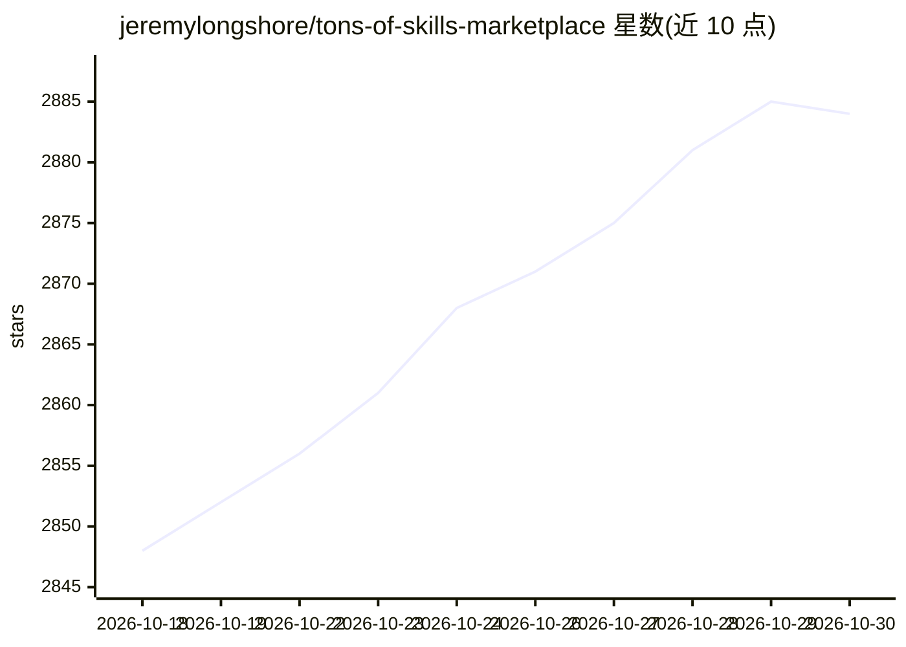

# jeremylongshore/tons-of-skills-marketplace

⭐ 2,884 · Python · MIT · 推送 2026-10-29 · [GitHub](https://github.com/jeremylongshore/tons-of-skills-marketplace) · [官网](https://tonsofskills.com) · 组织维护

**模型无关的 agent 技能市场平台：含包管理器与适配层**

面向 agent 技能的市场与分发平台：维护 harness 无关的 canonical 技能层，通过机器生成的适配器对接 harness（当前 Claude Code 为已验证原生 harness），并随附 ccpi 包管理器与 386 个 npm 包进行分发。仓库含 434 个目录插件、约 2,900 个技能、19 个分类；外部插件以镜像方式托管并锁定上游 commit 与许可。开发需 Node.js >=22.12.0 与 pnpm >=9.15.9。

## 筛选速览

| 维度 | 判定 | 备注 |
|---|---|---|
| AI 角色 | `ai-ecosystem` | LLM/agent 周边工具 |
| 许可风险 | `permissive` | MIT |
| 部署形态 | `library` | 以包/库形式分发 |
| 模型依赖 | — | README 未给出锁定关系 |
| 硬件要求 | — | 无带数字的原话,不猜 |
| 安装摩擦 | `low` | 无编译、无系统依赖或容器化 |
| 成熟度 | `idea` | |

## 能力要点

- harness 无关 canonical 层 + 机器生成适配器，Claude Code 为已验证原生 harness
- ccpi 包管理器，386 个 npm 包、周下载约 3,970 次
- 四类工件区分：canonical 技能/生成适配器/第一方包/上游镜像（锁 commit 与许可）
- 19 个分类、434 个目录插件、约 2,900 个技能，数字可复现

## 适用场景

- 为 Claude Code 或其他 agent harness 查找并安装技能插件
- 通过 ccpi CLI 或一键下载获取按任务组织的技能包
- 按分类浏览 agent 技能与 MCP 服务器生态

## 场景标签

 · 领域:AI agent 工具链/技能分发

## 证据(README 行号)

> L7: **A model-agnostic agent-skills platform.** The canonical layer is harness-free by construction; Claude Code is curr
> L33: pnpm add -g @intentsolutionsio/ccpi

## 星数曲线

2026-10-18 2,848 → 2026-10-30 2,884（+36）

---
*卡片 v1 · prompt 1.4 · 生成 2026-10-21 · 置信度 high · 依据 README sha `340cf9e1d390` · [字段定义](../../DATASET.md)*
