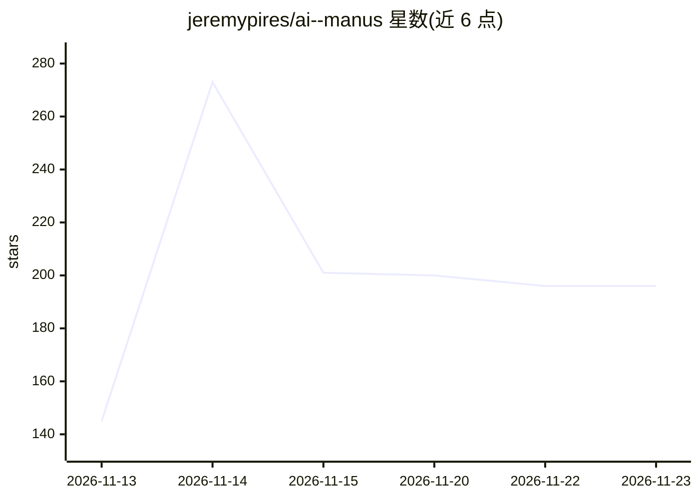

# jeremypires/ai--manus

⭐ 196 · Apache-2.0 · 推送 2026-11-14 · [GitHub](https://github.com/jeremypires/ai--manus) · 个人维护

**自主执行代码与控制浏览器的通用 AI Agent 系统**

面向终端用户的自主 AI 代理：用户以自然语言描述任务，代理自行编写并执行脚本、打开网页、填写表单、完成多步骤操作，可在后台作为个人助手运行，支持跨会话保持任务模式。定位为家庭、学习与轻量工作场景的小型工具，而非企业平台。README 给出 CPU/内存等兼容性要求表（最低 4 GB 内存、双核 CPU），但未提供具体安装命令、代码入口或技术实现细节，也未见沙箱运行机制的说明文字。

## 筛选速览

| 维度 | 判定 | 备注 |
|---|---|---|
| AI 角色 | `ai-native` | 本体是模型或模型工具 |
| 许可风险 | `permissive` | Apache-2.0 |
| 部署形态 | `None` |  |
| 模型依赖 | — | README 未给出锁定关系 |
| 硬件要求 | — | 无带数字的原话,不猜 |
| 安装摩擦 | `low` | 无编译、无系统依赖或容器化 |
| 成熟度 | — | 结构信号不足 |

## 能力要点

- 代理自主编写并执行代码完成任务
- 浏览器控制：导航网页、填写表单、采集信息
- 代码与浏览器动作可在同一任务流中衔接
- 声明支持后台常驻与跨会话任务模式记忆

## 适用场景

- 让 AI 代为整理研究资料、跑小脚本
- 自动浏览多个网页采集信息并汇总
- 把重复性的日常小任务委托给后台代理

## 场景标签

`AI 助手` `浏览器自动化` `编码 Agent` · 领域:效率与自动化

## 证据(README 行号)

> L10: - **Autonomous Code Execution:** Manus AI agent runs code on its own to complete tasks, so you can focus on decisio
> L18: Manus is an autonomous AI agent designed to run code and control a browser on your behalf. Instead of acting like a
> L22: Manus is not a heavy studio suite or a complex enterprise platform. It is a focused helper built for home, study, a

## 星数曲线

2026-11-13 145 → 2026-11-23 196（+51）

---
*卡片 v1 · prompt 1.4 · 生成 2026-11-17 · 置信度 mid · 依据 README sha `4347b4dd3fa7` · [字段定义](../../DATASET.md)*
