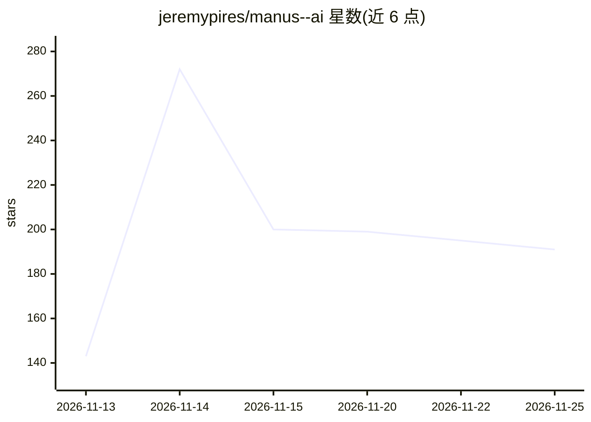

# jeremypires/manus--ai

⭐ 191 · Apache-2.0 · 推送 2026-11-14 · [GitHub](https://github.com/jeremypires/manus--ai) · 个人维护

**面向个人用户的自主 AI Agent：代跑代码与操控浏览器**

自主 AI 代理系统，在沙箱环境中代表用户执行工具与操作：自行编写并执行脚本、控制浏览器完成页面导航、表单填写与信息收集，并可执行多步任务，无需持续监督；脚本与浏览器动作可在同一流程中衔接。定位为家庭、学习与轻量办公场景的助手，而非企业平台。README 给出兼容性要求（最低 4GB 内存、双核 CPU）与上手步骤，但未提供具体安装命令、模型接入方式或代码结构说明。

## 筛选速览

| 维度 | 判定 | 备注 |
|---|---|---|
| AI 角色 | `ai-native` | 本体是模型或模型工具 |
| 许可风险 | `permissive` | Apache-2.0 |
| 部署形态 | `None` |  |
| 模型依赖 | — | README 未给出锁定关系 |
| 硬件要求 | — | 无带数字的原话,不猜 |
| 安装摩擦 | `low` | 无编译、无系统依赖或容器化 |
| 成熟度 | — | 结构信号不足 |

## 能力要点

- 自主编写并执行代码完成任务
- 浏览器控制：导航网页、填写表单、收集信息
- 代码执行与浏览器操作在同一工作流中衔接
- 支持跨会话记住并复用工作流模式

## 适用场景

- 让学生整理研究笔记、跑快速计算
- 代替人工跨多个网页收集数据并汇总
- 把脚本与浏览器操作组合起来自动化小型日常任务

## 场景标签

`浏览器自动化` `编码 Agent` `AI 助手` · 领域:效率与自动化

## 证据(README 行号)

> L10: - **Autonomous Code Execution:** Manus AI agent runs code on its own to complete tasks, so you can focus on decisio
> L18: Manus is an autonomous AI agent designed to run code and control a browser on your behalf. Instead of acting like a

## 星数曲线

2026-11-13 143 → 2026-11-25 191（+48）

---
*卡片 v1 · prompt 1.4 · 生成 2026-11-17 · 置信度 mid · 依据 README sha `885ad01e4b6b` · [字段定义](../../DATASET.md)*
