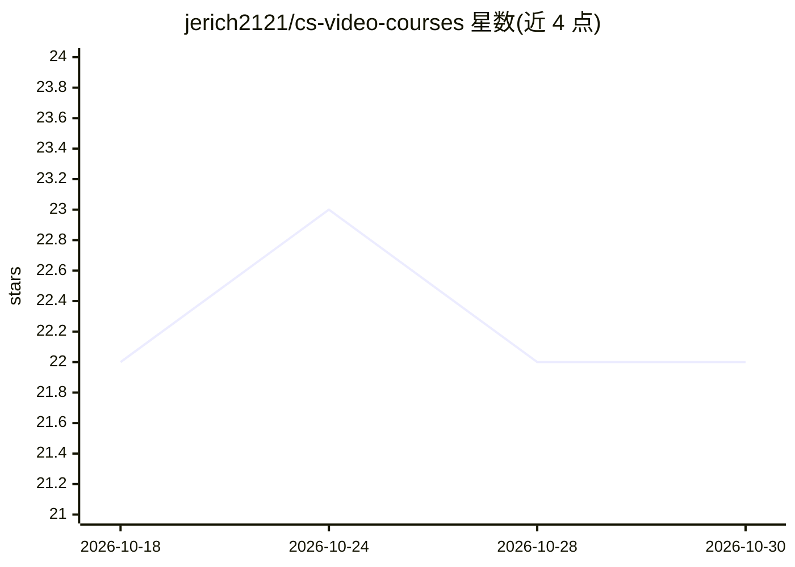

# jerich2121/cs-video-courses

⭐ 22 · 推送 2026-02-25 · [GitHub](https://github.com/jerich2121/cs-video-courses) · [官网](https://github.com/Developer-Y/cs-video-courses) · 个人维护

**计算机科学视频课程清单：聚合大学课程视频链接**

由社区维护的计算机科学课程视频讲座聚合清单，收录 MIT、Stanford、CMU、UC Berkeley、IIT 等高校的正式课程，覆盖计算机导论、数据结构与算法、系统编程、操作系统等主题，并含生物信息学、机器学习、计算机视觉等标签分类。条目以课程编号、年份、授课者与学校形式组织，通过 CONTRIBUTING.md 接受社区贡献，明确不接受小型 MOOC 或基础教程。清单为纯文档仓库，无安装或运行环节。

## 筛选速览

| 维度 | 判定 | 备注 |
|---|---|---|
| AI 角色 | `ai-knowledge` | 知识聚合/清单类 |
| 许可风险 | `none` | — |
| 部署形态 | `None` |  |
| 模型依赖 | — | README 未给出锁定关系 |
| 硬件要求 | — | 无带数字的原话,不猜 |
| 安装摩擦 | `medium` | 含编译或系统依赖之一 |
| 成熟度 | — | 结构信号不足 |

## 能力要点

- 聚合多所高校正式课程的视频讲座链接
- 按主题分类（导论、算法、系统编程、操作系统等）
- 接受 PR 贡献，明确排除 MOOC 与基础教程

## 适用场景

- 按主题查找高校计算机科学课程的视频资源
- 自学时按课程体系选择系统性课程

## 场景标签

`教程课程` `精选清单` · 领域:学习与行业

## 证据(README 行号)

> L1: # Computer Science courses with video lectures
> L18: - CS 10 - The Beauty and Joy of Computing - Spring 2015 - Dan Garcia - UC Berkeley InfoCoBuild

## 星数曲线

2026-10-18 22 → 2026-10-30 22（+0）

---
*卡片 v1 · prompt 1.4 · 生成 2026-10-27 · 置信度 high · 依据 README sha `0caec60ef2a5` · [字段定义](../../DATASET.md)*
