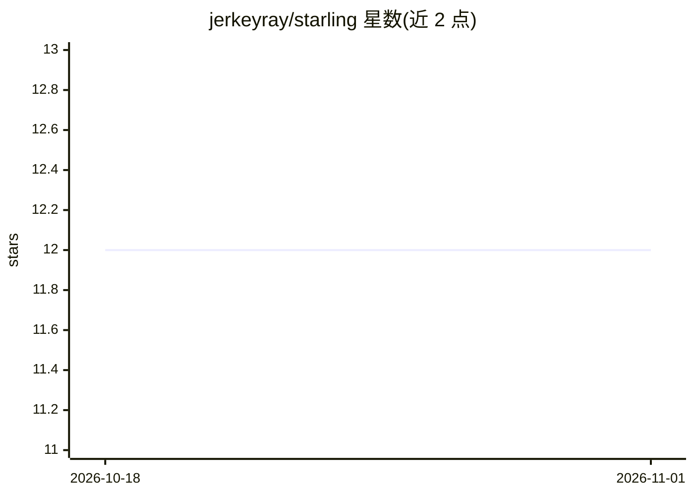

# jerkeyray/starling

⭐ 12 · Go · Apache-2.0 · 推送 2026-05-07 · [GitHub](https://github.com/jerkeyray/starling) · [官网](https://starling.jerkeyray.com) · 个人维护

**事件溯源的 Go Agent 运行时：可回放、可审计的 LLM 智能体执行框架**

面向 Go 开发者的 Agent 开发框架（ADK）：将 agent 循环建模为类型化的仅追加事件流，用 BLAKE3 哈希链与 Merkle 根承诺整个 run，从而提供确定性回放、断点续跑、防篡改审计、预算控制与浏览器 Inspector。支持 OpenAI 兼容 API、Anthropic、Gemini、Bedrock、OpenRouter 五类 provider 适配器，MCP 工具（stdio/HTTP），SQLite/Postgres 持久化后端，starlingtest 无 LLM 测试包，以及 starlingd HTTP 守护进程。当前处于 beta，beta 版本间允许破坏性变更，建议固定 tag。

## 筛选速览

| 维度 | 判定 | 备注 |
|---|---|---|
| AI 角色 | `ai-ecosystem` | LLM/agent 周边工具 |
| 许可风险 | `permissive` | Apache-2.0 |
| 部署形态 | `library` | 以包/库形式分发 |
| 模型依赖 | local-ok | 支持本地模型 |
| 硬件要求 | — | 无带数字的原话,不猜 |
| 安装摩擦 | `low` | 无编译、无系统依赖或容器化 |
| 成熟度 | `idea` | |

## 能力要点

- 事件日志为唯一事实来源，BLAKE3 哈希链 + Merkle 根支持回放/续跑/审计
- 五类 provider 适配器经统一 conformance 套件覆盖
- MCP 工具接入（官方 Go SDK，stdio 子进程与 streamable HTTP）
- starlingtest 脚本化 provider，agent 测试无需真实 LLM
- CLI 含 validate/export/replay/prune/contracts 等子命令

## 适用场景

- 生产环境 LLM agent 的确定性回放与回归测试
- 对 agent 运行记录做防篡改审计与成本预算控制
- 通过浏览器 Inspector 排查回放分叉与 run 明细
- 将自有 agent 以 HTTP 服务（starlingd）形式对外提供

## 场景标签

`Agent 框架` · 领域:Agent 开发

## 证据(README 行号)

> L3:  Event-sourced agent runtime for Go.
> L12: That's the whole pitch. Starling treats the agent loop as a stream of
> L42: - **Provider adapters**: OpenAI-compatible APIs, Anthropic, Gemini, Amazon

## 星数曲线

2026-10-18 12 → 2026-11-01 12（+0）

---
*卡片 v1 · prompt 1.4 · 生成 2026-11-01 · 置信度 high · 依据 README sha `64f5ae631aa6` · [字段定义](../../DATASET.md)*
