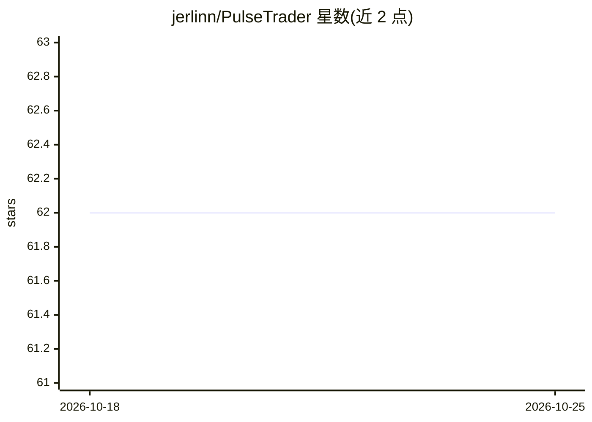

# jerlinn/PulseTrader

⭐ 62 · Python · NOASSERTION · 推送 2026-03-29 · [GitHub](https://github.com/jerlinn/PulseTrader) · 个人维护 · 中文 README

**面向个人投资者的 AI 量化分析工具：精确技术指标 + LLM 洞察**

输入股票名称即可获得技术分析图表与 AI 分析报告的工具。计算层用确定性算法（Wilder RSI、SuperTrend、成交量三信号）生成可手工验证的指标，数据存于 SQLite 统一数据库，支持 A 股与港股自动识别；分析层通过 LLM 产出交易洞察，计算与 AI 推理分离。需申请 AIHUBMIX API Key，技术指标计算依赖 .NET Runtime，以 Python 脚本方式从源码运行。项目声明仅供学习研究、不构成投资建议。

## 筛选速览

| 维度 | 判定 | 备注 |
|---|---|---|
| AI 角色 | `ai-native` | 本体是模型或模型工具 |
| 许可风险 | `none` | NOASSERTION |
| 部署形态 | `None` |  |
| 模型依赖 | — | README 未给出锁定关系 |
| 硬件要求 | — | 无带数字的原话,不猜 |
| 安装摩擦 | `medium` | 含编译或系统依赖之一 |
| 成熟度 | — | 结构信号不足 |

## 能力要点

- 技术指标 100% 确定性算法，计算与 LLM 推理分离
- SQLite 统一数据库管理行情与指标数据
- 成交量三信号识别：极致缩量、放量、爆量
- 支持 A 股与港股代码自动识别与跨市场搜索

## 适用场景

- 输入股票名称快速获得技术指标图表与 AI 分析报告
- 用量价关系和 RSI 背离辅助分析个股趋势
- 学习量化指标计算与 LLM 分析分离的架构实践

## 场景标签

`金融量化` · 领域:学习与行业

## 证据(README 行号)

> L51: **Agent Z 交易助手**的核心能力：
> L90: **数据精确性**：100% 算法可靠，每个计算结果可手工验证，LLM 推理与数据计算完全分离
> L101: 该项目的分析模块需要 AIHUBMIX API KEY，先到 Aihubmix 官网申请。

## 星数曲线

2026-10-18 62 → 2026-10-25 62（+0）

---
*卡片 v1 · prompt 1.4 · 生成 2026-10-24 · 置信度 mid · 依据 README sha `fd8a8d122065` · [字段定义](../../DATASET.md)*
