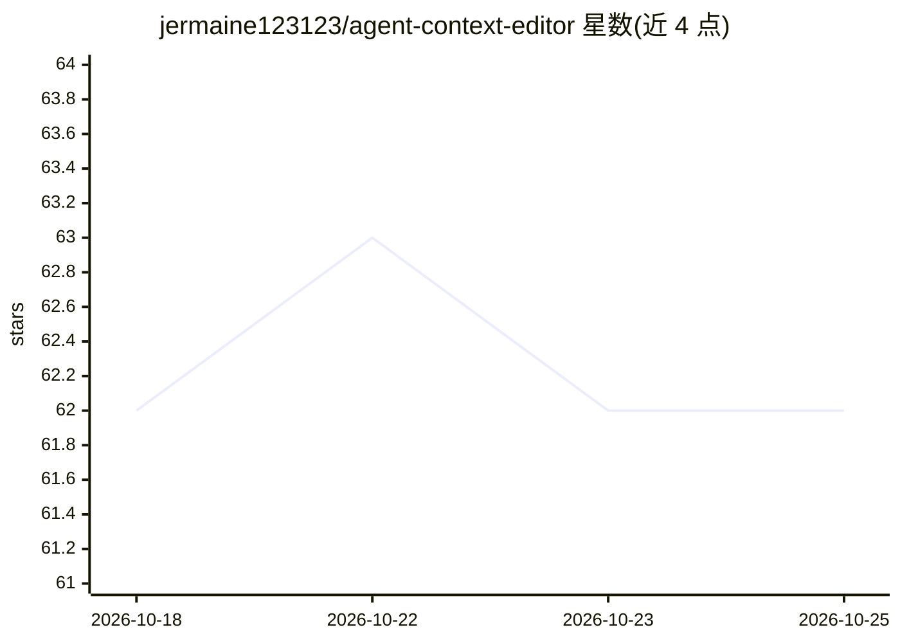

# jermaine123123/agent-context-editor

⭐ 62 · JavaScript · MIT · 推送 2026-10-01 · [GitHub](https://github.com/jermaine123123/agent-context-editor) · 个人维护 · 中文 README

**跨 Agent 插件：手动排除/编辑/压缩 AI 对话上下文**

面向 Pi TUI、Pi Desktop/RPC 与 DeepSeek Harness 的上下文管理插件：读取既有会话，将 User/AI 推理/回答/工具内容呈现在独立视图中，支持手动排除与恢复上下文、编辑纯文本消息、AI 摘要压缩选定内容，以及搜索、过滤、批量选择、视觉隐藏与撤销；所有更改不覆盖原始会话，仅改变发送给模型的派生输入。编辑范围受限（推理、工具、签名回答等不可编辑），Pi Desktop/RPC 不支持模型级排除与编辑。通过 pi install 与 dsh plugin 命令安装。

## 筛选速览

| 维度 | 判定 | 备注 |
|---|---|---|
| AI 角色 | `ai-ecosystem` | LLM/agent 周边工具 |
| 许可风险 | `permissive` | MIT |
| 部署形态 | `None` |  |
| 模型依赖 | locked-api |  |
| 硬件要求 | — | 无带数字的原话,不猜 |
| 安装摩擦 | `low` | 无编译、无系统依赖或容器化 |
| 成熟度 | — | 结构信号不足 |

## 能力要点

- 手动排除/恢复上下文与编辑纯文本 User 消息和完整未签名回答
- 选定内容 AI 摘要压缩，可编辑、应用与恢复
- 原始 Session 全程保留，视觉隐藏与模型输入变更分开存储
- 支持 Pi TUI、Pi Desktop/RPC、DeepSeek Harness 三个宿主

## 适用场景

- 长会话中手动剔除失败尝试与无关历史以应对 context rot
- 自动压缩丢失了值得保留的细节时手动干预上下文
- 跨多个 Agent 宿主统一管理对话上下文

## 场景标签

`Agent 记忆` · 领域:Agent 开发

## 证据(README 行号)

> L3: Agent Context Editor is a cross-agent plugin for manually excluding, editing, and selectively compressing AI convers
> L32: |Feature|Pi TUI|Pi Desktop/RPC|DeepSeek Harness|
> L92: ## How it works

## 星数曲线

2026-10-18 62 → 2026-10-25 62（+0）

---
*卡片 v1 · prompt 1.4 · 生成 2026-10-24 · 置信度 high · 依据 README sha `19d351c10193` · [字段定义](../../DATASET.md)*
