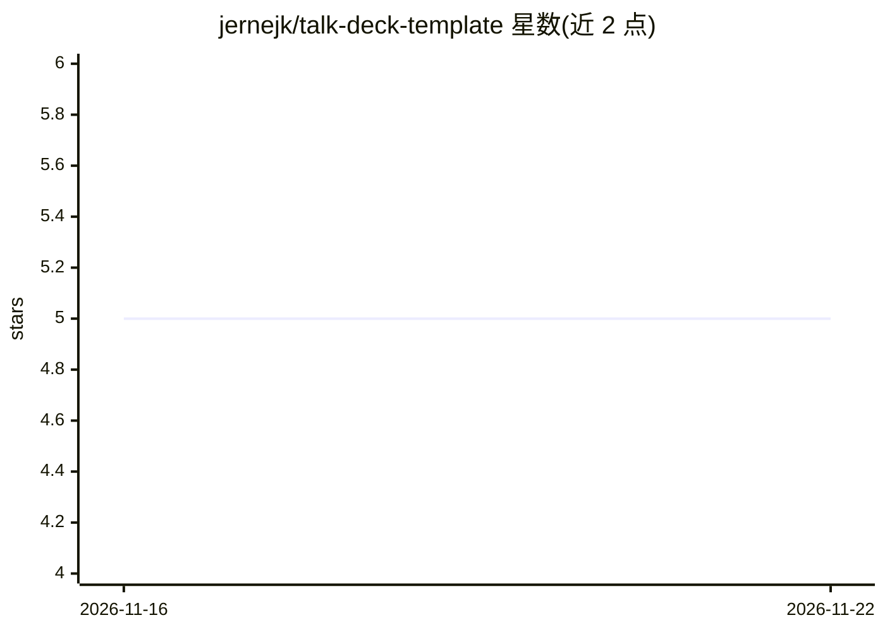

# jernejk/talk-deck-template

⭐ 5 · JavaScript · MIT · 推送 2026-11-18 · [GitHub](https://github.com/jernejk/talk-deck-template) · [官网](https://talk-deck-template.surge.sh) · 个人维护

**给演讲者的 AI-first HTML 幻灯片模板，由编码代理生成**

纯 HTML/CSS 的演示文稿模板，自带小型渲染引擎：无构建步骤、无 CDN、无 Web 字体，每套 deck 可从 file:// 离线运行。工作流是 AI-first：用户把要讲的内容告诉编码代理，由代理按 AGENTS.md 的规则生成幻灯片与讲者备注；npm run new 脚手架新建 talk，npm run add 插入 68 种幻灯片模式，npm run qa 用 Playwright 渲染每页并在溢出、媒体损坏和控制台报错时失败。支持讲者备注、概览、排练计时、单文件导出与 surge 发布。

## 筛选速览

| 维度 | 判定 | 备注 |
|---|---|---|
| AI 角色 | `ai-enhanced` | 去掉 AI 部分产品仍成立 |
| 许可风险 | `permissive` | MIT |
| 部署形态 | `library` | 以包/库形式分发 |
| 模型依赖 | — | README 未给出锁定关系 |
| 硬件要求 | — | 无带数字的原话,不猜 |
| 安装摩擦 | `low` | 无编译、无系统依赖或容器化 |
| 成熟度 | — | 结构信号不足 |

## 能力要点

- AGENTS.md 指导编码代理按规则撰写幻灯片
- 68 种幻灯片模式，7 个模板与多种配色
- npm run qa 渲染每页幻灯片并检查溢出/媒体/控制台错误
- 无构建步骤，deck 从 file:// 离线运行，支持单文件导出

## 适用场景

- 让编码代理在几小时内生成一套可演讲的幻灯片
- 准备带现场 demo 与截图兜底的会议演讲
- 用模板统一维护多套 deck 的风格与议程页

## 场景标签

`代码生成` · 领域:编码与开发

## 证据(README 行号)

> L11: Now I work AI-first. I tell a coding agent what I know and what I want to say, and it builds the slides, notes and 
> L13: This template is the setup behind that. Decks are plain HTML and CSS with a small engine: no build step to present,

## 星数曲线

2026-11-16 5 → 2026-11-22 5（+0）

---
*卡片 v1 · prompt 1.4 · 生成 2026-11-21 · 置信度 high · 依据 README sha `ce64ae8f3f36` · [字段定义](../../DATASET.md)*
